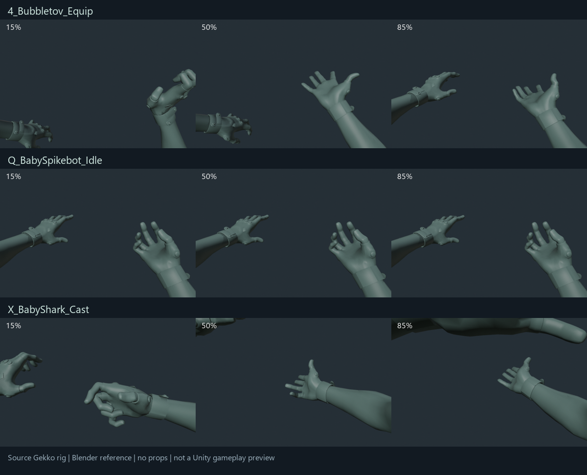

# Animation dùng vật phẩm: nghiên cứu asset hiện tại

Ngày: 09/10/2026. Unity 6000.5.6f1. Chỉ nghiên cứu; không sửa gameplay, prefab hoặc Animator.

## Kết luận

Đang thiếu clip được author riêng cho mở medkit, băng bó và tiêm. Gameplay hồi máu/chữa nhiễm đã tồn tại. `SurvivalPresentation` hiện giấu súng, đưa vật phẩm lên và điều chỉnh hai cánh tay bằng IK. Medkit và antidote dùng cùng kiểu chuyển động, chỉ khác vị trí nắm; chưa tách động tác tự dùng và dùng cho đồng đội.

Có thể tái dùng một phần chuyển động lấy/cầm/kiểm tra đồ. Chưa tìm được clip y tế trong thư viện đã kiểm tra có thể thay vào trực tiếp mà cho động tác đúng.

## Bằng chứng và phạm vi

- Unity AssetDatabase trả về 274 đường dẫn asset chứa animation (bao gồm FBX chứa nhiều subclip; đây không phải tổng số clip).
- Đã đọc danh sách subclip của 22 model trong Players/Weapons, gồm Hand của Brimstone/Gekko, sáu bộ súng và nguồn grenade 1P/3P.
- Các truy vấn Medkit/Heal/Antidote tìm thấy prefab, âm thanh, hiệu ứng và icon. Các truy vấn Syringe/Bandage/Adrenaline không có kết quả theo tên; kết quả này không loại trừ asset đặt tên khác.
- Gekko `Hand.fbx` và Classic `FP_Classic.fbx` đều được Unity báo là Generic, NoAvatar, không Humanoid.
- Codebase Memory được truy vấn trước khi đọc source. Index ghi ngày 06/10/2026, nhưng báo coverage unavailable/metadata changed ở các file liên quan; kết luận runtime được đối chiếu trực tiếp với source hiện tại.
- Ảnh Gekko là các mẫu tại 15%, 50%, 85% thời lượng trên rig nguồn trong Blender, không có đạo cụ. Ảnh này dùng đánh giá tư thế, chưa chứng minh tích hợp Unity.

## Clip đáng cân nhắc

Tên dưới đây là hậu tố của tên clip dài trong FBX. Thời lượng là số Unity báo cho clip nguồn, không phải thời gian gameplay đã hiệu chỉnh.

| Clip | Nguồn | Thời lượng | Có thể tái dùng | Giới hạn |
| --- | --- | --- | --- | --- |
| `FP_AggroBot_S0_4_Bubbletov_Equip` | Gekko Hand | 3.25 s | Đoạn đưa tay/lấy vật nhỏ ra | Cả clip có động tác tung/đón; cần cắt đoạn và sửa nắm vật |
| `FP_AggroBot_S0_Q_BabySpikebot_Idle` | Gekko Hand | 19.5 s | Tham khảo hai tay cầm/đỡ vật trước camera | Ngón tay mở, không phải nắm túi medkit; cần sửa cổ tay/ngón tay và chọn đoạn loop |
| `FP_AggroBot_S0_X_BabyShark_Cast` | Gekko Hand | 2.083 s | Tham khảo đưa cẳng tay ra trước camera | Không có tiếp xúc kim hoặc bấm piston; chỉ làm nền pose cho tự tiêm |
| `FP_AggroBot_S0_E_BabyZamboni_Equip` | Gekko Hand | 3.125 s | Ra hiệu/tương tác từ xa | Cử chỉ ngón tay rõ nét; không nên dùng cho chữa thương |
| `FP_Core_BasePistol_S0_Inspect` | Classic FP | 8 s | Ứng viên tham khảo kiểm tra lọ thuốc/vật nhỏ bằng một tay | Được author cho pistol; chưa xác nhận grip và đường xương trên bốn nhân vật |
| `FP_Core_BasePistol_S0_Reload` | Classic FP | 4.583 s | Tham khảo động tác tay phụ lấy/lắp vật nhỏ | Động tác tháo/lắp băng đạn; không tương đương tiêm |
| `FP_Core_BattleRifle_S0_Reload` | Warden FP | 9.167 s | Tham khảo thao tác hai tay cho medkit | Bố cục tay theo súng dài; phải sửa đáng kể mới thành mở túi/băng bó |
| `FP_Core_Grenade_OverhandThrow` + `TP_Core_Grenade_ThrowPrimary_UB_Montage` | Grenade 1P/3P | 2.667 / 1.875 s | Ném frag/incendiary | Project đã có luồng `GrenadeThrowAnimation`; không phải khoảng thiếu y tế |

## Hướng ít sửa nhất

1. Medkit: lấy một đoạn chuyển động đưa tay lên làm phần vào/ra; author phần giữ túi, mở/lấy băng và thao tác băng bó trên rig đang dùng. Loop phần thao tác theo tiến độ server.
2. Tiêm: author phần giữ syringe bằng tay phải, đưa cẳng tay trái vào khung, chạm kim, bấm piston rồi rút kim. `X_BabyShark_Cast` chỉ nên dùng làm tham khảo tư thế cẳng tay.
3. Chữa đồng đội: dùng tư thế đưa hai tay về mục tiêu khác tư thế tự chữa; 3P ưu tiên chuyển động thân trên để giữ locomotion.
4. Tái dùng `SurvivalInventory.IsUsingItem`, `ActiveConsumable`, `IsSelfUse`, `UseProgress` và lifecycle cancel/complete hiện có. Có thể dùng cách layer theo thời gian server của grenade làm mẫu; phần y tế phải không bị IK hiện tại ghi đè lên clip mới.

Thời gian gameplay hiện tại: medkit 4 s tự dùng / 2.5 s hỗ trợ; antidote 5 s tự dùng / 3 s hỗ trợ. Giữ thời điểm trừ vật phẩm và hồi máu/chữa nhiễm do server quyết định.

## Đạo cụ và rig

- Có `Content/Visuals/Medkit.prefab` và `AntidoteVial.prefab`. Tài liệu triển khai mô tả đây là geometry đơn giản. Vial là lọ thuốc, chưa có asset syringe được tìm thấy theo tên.
- Clip Generic phụ thuộc đường xương và rest pose. Cùng tên xương không đủ để gán trực tiếp; vẫn phải kiểm tra/rebind/bake cho Brimstone, Clove, Gekko và Sage.
- Clip Humanoid từ bên ngoài sẽ cần chuyển rig hoặc bake sang hierarchy hiện tại. Chưa có cơ sở chọn một pack bên ngoài: dịch vụ tìm kiếm web không trả được kết quả sử dụng được trong phiên này.

## Source đã đối chiếu

- `Assets/FPS/Features/Survival/Runtime/SurvivalPresentation.cs`: vật phẩm và IK y tế.
- `Assets/FPS/Features/Survival/Runtime/SurvivalArmPose.cs`: chỉ điều chỉnh upper/lower arm; không author động tác ngón tay hoặc piston.
- `Assets/FPS/Features/Survival/Runtime/SurvivalInventory.cs`: tự dùng/hỗ trợ, tiến độ server, hủy và hoàn tất.
- `Assets/FPS/Features/Survival/Runtime/SurvivalRules.cs`: thời lượng.
- `Assets/FPS/Features/Survival/Runtime/GrenadeThrowAnimation.cs`: clip/layer grenade theo thời gian server.
- `Documents/Survival-Items-Implementation.md`: mô tả placeholder và nguồn nội dung đã nhập.

## Cập nhật tích hợp — 10/10/2026

Animation tự tiêm V5 đã gắn vào gameplay trên cả bốn prefab Brimstone, Clove, Gekko và Sage, dùng mesh/material gốc của từng nhân vật. Brimstone có clip hiệu chỉnh điểm tiêm tránh giáp tay; khớp tay áo Sage đi theo phần xoắn cẳng tay. Hai lượt Play Mode đã qua: kiểm tra toàn bộ bốn prefab với host/client NGO, hủy/khởi động lại/hoàn tất và trả lại tay/súng; kiểm tra hồi quy medkit/incendiary hiện có. Ảnh runtime được đối chiếu ở 16:9 và 21:9. Chi tiết và ảnh mới ở [Integration/README.md](Integration/README.md).

Chưa author anim mới cho medkit, chữa đồng đội hoặc 3P; chưa chạy player build. Không tải/mua asset. Kho nguồn cũ `E:\ProjectSettings\Assets` được tài liệu nhắc tới hiện không còn ở đường dẫn đó, nên chưa khảo sát được.
