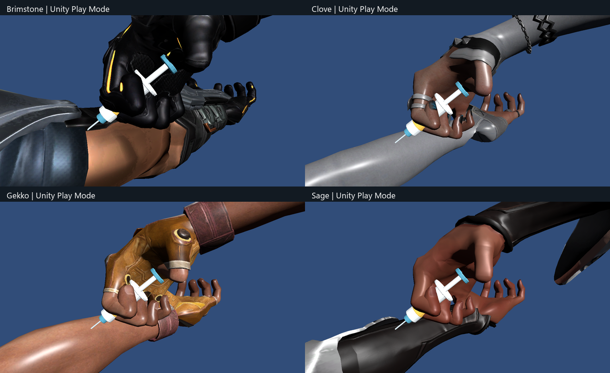

# Self-injection integration — 10 October 2026

The approved five-second V5 self-antidote animation is installed on Brimstone, Clove, Gekko and Sage player prefabs. Each character keeps its original first-person mesh and materials. Production viewmodels, copied skin meshes and clips are under `Assets/FPS/Features/Survival/Content/MedicalAnimation`.

`SelfInjectionAnimation` samples a manual AnimationClipPlayable from SurvivalInventory's server progress. SurvivalPresentation selects it for the owner's self-antidote action, hides the original hands/gun and skips the previous medical IK. Cancellation, completion, disable and despawn restore presentation. Inventory consumption and infection reduction remain server-authoritative.

Brimstone has a baked calibration clip: it presents the exposed upper arm instead of targeting the gauntlet, solves the right elbow for the changed reach and retains the grip and forearm twist. Installation checks all 121 authored samples for wrist bend <= 35 degrees. Sage's sleeve accessories follow the corresponding forearm twist bones so the sleeve stays with the arm during entrance and retreat.

Unity 6000.5.6f1 Play Mode checks:

- `SelfInjectionUsesAllFourCharactersAndRestoresPresentation`: **1/1 passed**, job `4b776382`. Real NGO host/client fixture, all four authored player prefabs; verifies playback, original materials, bone references, hidden hands/guns, cancellation at 2%, 50% and 98%, restart, restoration, and one antidote consumed only on server completion.
- `AuthoredPlayerMedicalPresentationAndIncendiaryCollision`: **1/1 passed**, job `3e62f477`. Existing medkit/presentation and incendiary collision regression.
- Visually reviewed runtime captures at 0.50, 2.50 and 4.25 seconds, 16:9 and 21:9, using the authored camera setup. The Brimstone contact is visible on exposed skin; Sage's detached sleeve fragment from the initial integration is absent at entrance/retreat.

All runtime captures: `Documents/UIUX/SelfInjection-{character}[-wide]-{time}.png`. Full pose comparison: [entrance, injection, retreat](FourPlayers-Unity-runtime.png).

To regenerate assets: Unity menu **Tools > FPS > Medical Animation > Install On Players**. It saves authored scenes and assets before/after the operation and preserves existing asset GUIDs.

Scope: self-antidote in first person. New medkit/support/third-person animation and a player build were not part of this integration. Clove and Sage retain their native sleeves; skin contact authoring measurements from the original Gekko prototype do not establish contact tolerances on the other meshes. Camera framing outside the reviewed FOV/aspects needs another visual check.
