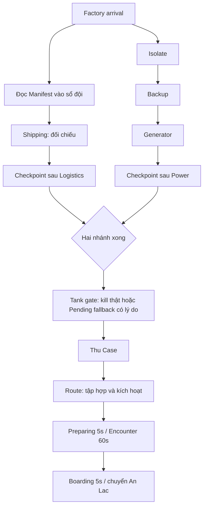
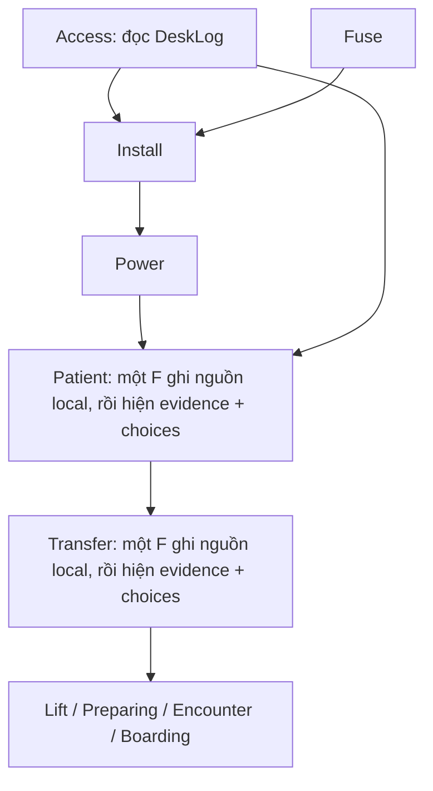
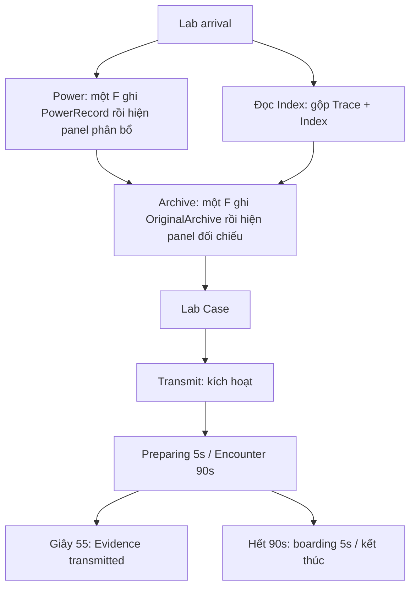

# P0 v3 — Flow đề xuất để duyệt

Ngày 29/10/2026. **P0 v3 ĐƯỢC DUYỆT CÓ ĐIỀU KIỆN; ĐÃ GHI CÁC ĐIỀU KIỆN BỔ SUNG. P1 ĐƯỢC CHẠY; CHƯA DUYỆT MOCKUP, CHƯA CHO PHÉP CODE.** Bot 0 lập bản trình này từ ba báo cáo và quyết định Q1–Q7/D1(c) mới nhất; Bot 4 là vai phụ trách thiết kế trong kế hoạch. Bot 5/6 đã được khởi chạy làm P1 theo lệnh mới; Bot 5 là người duy nhất điều khiển Editor/Play/lifecycle/save, Bot 6 phối hợp kiểm asset/HUD. Bot 0 chỉ ghi báo cáo; chưa sửa code/scene/asset theo flow.

Đọc cùng [bản tổng hợp đã cập nhật](E:/Unity/Project/FPS/Reports/00-synthesis.md). Các mục **[ĐỀ XUẤT / INFERENCE]** dưới đây là chi tiết để người dùng duyệt, không phải quyết định đã được ngầm phê chuẩn. Dữ kiện hiện trạng có nhãn CODE/SCENE. Kết quả P1 do Bot 5/6 ghi riêng, không coi kiểm spec là playtest. [Điều kiện duyệt mới nhất](E:/Unity/Project/FPS/Reports/04-flow-proposal-v3-conditions.md) là phần cập nhật hiện hành. [Chỉ phần thay đổi v3](E:/Unity/Project/FPS/Reports/04-flow-proposal-v3-changes.md); [v2 lưu lịch sử](E:/Unity/Project/FPS/Reports/P0v3Evidence/04-flow-proposal-v2.md) không phải spec hiện hành. Các phần v3 và điều kiện bổ sung thay thế nội dung tương ứng ở v2/bản trình v3 trước duyệt.

## 1. Phần xin duyệt ở P0

Đề xuất giữ ba chương, hai nhánh Factory, các câu đố và giá trị đáp án hiện có; thay cách người chơi thu dữ kiện, nhận hướng dẫn và phục hồi khi gate lỗi. Giữ tên canon, gồm **An Lac**. Thống nhất hai tên chức năng: **Manifest = đọc chứng từ**, **Shipping = đối chiếu chứng từ**; không gọi cả hai là Manifest hoặc “mở hộp điện”.

Những hướng đã được người dùng quyết: một người đọc cho cả đội; panel hiện chứng cứ cạnh choices sau khi thu; Lab gộp Trace+Index; viết lại nội dung gợi đáp án; báo fallback; host đặt lại vị trí Tank; ép đóng cửa; đưa theo người sống sau timeout; checkpoint sau nhánh; sửa save/Downed; HUD nhóm tương tác trước; năm cue tối thiểu và xem lại thoại text-only.

**Đã duyệt:** P0 v3 có điều kiện; S1 Shipping thùng (20), nhận diện trước ngắm bằng asset sẵn là điều kiện; Downed trên bản sao lưu, cửa 5+3, lịch sử trong phiên và phạm vi năm cue. **Điều kiện mới đã ghi:** hoãn auto hint khi đang tiến gần; HP Tank và thông báo cả đội khi mở recovery, áp dụng cả ba chương Active; Lift thử bốn người, chỉ xin mở rộng nếu cần; tách đèn trạng thái/viền mục tiêu; chấm T_excess sau trừ combat và giữ số thô. Âm máy phát thiếu tạm được chấp nhận. Các ngưỡng nhận biết chuyển động cụ thể trong §2.3 là đề xuất để baseline rà; không tự coi chúng đã đo. P2 chờ người dùng chọn cách làm HUD, không yêu cầu ảnh mẫu. Chưa cho phép code.

Diff [AGENTS đề xuất](E:/Unity/Project/FPS/Reports/AGENTS-clarification.proposed.diff) chưa áp dụng; user đang yêu cầu duyệt diff riêng. Chỉ dẫn Q1 mới nhất ưu tiên hơn cách hiểu cấm mọi giá trị đáp án trên panel ở AGENTS: được hiện **nguyên dữ kiện đã thu** cạnh lựa chọn. Hint/tracker/title không ghi sẵn đáp án hoặc kết luận. Đối chiếu là người chơi đọc và so, không phải UI tô sẵn lựa chọn đúng.

### 1.1. Bảng duyệt flow theo kiểm 5 giây

**[ĐỀ XUẤT]** Mỗi hàng trả lời được việc cần làm, thân vật/khu phải đến và kết quả nhìn thấy. F là phím mặc định, UI lấy binding thật. Khi khóa luôn icon khóa + “Cần: …”, không [F]. Từ chối/sai/hủy có cue Từ chối một lần; hoàn tất có chữ+cue+tick/pulse marker sau state server (§7). “Không có đáp án” ở bước thao tác nghĩa là không dựng lựa chọn để người chơi đoán; lỗi điều kiện vẫn phải nói rõ.

| Bước | 5 giây: làm gì / ở đâu / xong sẽ thấy gì | Dữ kiện cần có trước | Phản hồi khi khóa/sai/hủy |
|---|---|---|---|
| F0 — Arrival / D1(c) | Theo marker **Manifest — Read logistics record · {m}** tới nguồn Manifest; subtitle mở đầu chỉ dẫn đọc cho đội rồi đối chiếu tại Shipping. Xong đọc sẽ thấy ĐÃ GHI và đích Shipping. | Không cần file trước; giữ vị trí arrival/Manifest. | Khóa: giai đoạn chưa cho điều khiển ghi “Đang vào khu vực”; sai/hủy: không có confirm tại arrival, mất route dùng marker tên+đích thẳng, không im lặng. |
| F1 — Manifest | Nhấn F đọc tại thân Manifest hiện có; thấy “Manifest recorded for the squad”, Missions ĐÃ GHI, marker Shipping. | Exploring; nguồn FactoryManifest hợp lệ, trong tầm/LOS. | Khóa: “Cần: tới nguồn Manifest”; sai: không có choice, xa/che báo đúng lý do; hủy: đóng trang, file server đã ghi vẫn còn, không phát thưởng lần nữa. |
| F2 — Shipping | Tại Shipping, so hai nhóm trường với Manifest rồi giữ F 2 s; thấy Logistics complete + kết quả lưu checkpoint, đích Power còn thiếu hoặc Tank gate. | HasFile(FactoryManifest); trích đoạn cạnh choices. | Khóa: “Cần: đọc Manifest”; sai: nêu nhóm mã/niêm phong hoặc điểm nhận/thời điểm lệch, không nêu giá trị đúng; hủy: “Đã hủy: nhả F/ra khỏi tầm/bị che”, vòng về 0, giữ lựa chọn. |
| F3 — Isolate | Giữ F 2 s tại Isolate; thấy đèn báo mạch local tắt, tag khi ngắm “ISOLATED”, chữ/cue hoàn tất và marker Backup. | Exploring; asset/giới hạn §3.1. | Khóa/sai có lý do. Hủy: vòng về 0, trạng thái thiết bị chưa đổi; không tắt đèn trước Accepted. |
| F4 — Backup | Giữ F 2 s tại Backup; thấy đèn báo local sáng trắng, tag “BACKUP READY”, chữ/cue hoàn tất, marker Generator. | Isolate xong; asset/giới hạn §3.1. | Khóa: “Cần: Isolate”. Sai/hủy có lý do; đèn chỉ đổi sau state server. |
| F5 — Generator | Giữ F 3 s tại máy phát; thấy đèn “running” local sáng ổn định, tag “RUNNING”, Power complete/checkpoint; âm máy là hạng mục thiếu clip ở §3.1. | Backup xong; giữ nguyên máy phát/binding. | Khóa: “Cần: Backup”. Sai/hủy có lý do; không phát máy chạy hoặc đổi đèn nếu chưa Accepted. |
| F6 — Tank Factory | Pending: đợi kiểm tra có đếm giờ; Active: hạ Tank theo marker Tank. Sau kill thật **hoặc** fallback được báo rõ, thấy Case unlocked và marker Case. | Shipping + Generator. Outcome server phân biệt kill/fallback. | Khóa: “Cần: hoàn tất hai nhánh/kiểm tra Tank/hạ Tank” theo đúng state; sai: không có choice, không gọi fallback là kill; hủy: không có hold, host recovery/Retry có chữ riêng (§6.1). |
| F7 — Case | Giữ F 3 s tại Case; thấy Case secured và marker Route. | Hai nhánh complete + gate Tank resolved. | Khóa: nêu đúng prerequisite còn thiếu; sau fallback không nhắc hạ Tank; sai: báo xa/che/busy, không có choice; hủy: vòng về 0 và nguyên nhân, Case chưa thu. |
| F8 — Route | Giữ F 3 s tại Route trong preparationArea; thấy Regroup here và danh sách READY. | Case complete. | Khóa: “Cần: thu Case”; sai: “Vào khu tập hợp để kích hoạt tuyến” hoặc lý do range/LOS; hủy: vòng về 0, chưa Preparing. |
| F9 — Rời Factory | Tập hợp → giữ tuyến 60 s → vào boarding; thấy marker theo từng phase, sau chuyển xong mới hiện An Lac. | Route đã kích hoạt; chính sách G1–G4 bên dưới. | Khóa/sai/hủy: dùng phản hồi G1–G4, không chỉ “Wait for squad”; không tính countdown bị hủy là complete. |
| A1 — Access | F đọc Access tại nguồn hiện có; thấy Access log recorded, marker Fuse hoặc Install. | Exploring; nguồn AsylumDeskLog đọc được. | Khóa: phase/actor có lý do; sai: báo xa/che/busy, không có choice; hủy: đóng trang không xóa file đã ghi. |
| A2 — Fuse | F lấy service fuse tại vật hiện có; thấy fuse recovered, Install mở khi Access cũng xong. | Exploring; không cần Access để lấy. | Khóa: phase/actor có lý do; sai: từ chối có nguyên nhân, không có choice; hủy: thao tác tức thời chưa Accepted thì chưa nhận, Accepted rồi không thu lại lần hai. |
| A3 — Install | Giữ F 2 s tại service cabinet; thấy Fuse installed, marker Power. | Access + Fuse complete. | Khóa: liệt kê Access/Fuse còn thiếu; sai: báo xa/che/busy; hủy: ghi nguyên nhân, vòng về 0, fuse chưa lắp. |
| A4 — Power | Giữ F 2 s tại cabinet; thấy Records room powered, marker nguồn Patient. | Install complete. | Khóa: “Cần: lắp service fuse”; sai: không có choice, từ chối có lý do; hủy: vòng về 0 và nguyên nhân. |
| A5 — Patient, gộp đọc + đối chiếu | Tại bàn Patient: nhấn F một lần ghi PatientRecord và hiện nó cạnh DeskLog + choices; chọn, giữ F 2 s; thấy Patient recorded, marker Transfer. | Access + Power và DeskLog đã thu; PatientRecord được đọc hợp lệ ngay tại bàn trước khi choices hiện. | Khóa: nêu Power/DeskLog còn thiếu, không [F] cho hành động khóa; nguồn local còn đọc được khi hợp lệ. Sai: tên trường mã/nhóm/thời điểm lệch. Hủy: vòng về 0 + lý do; giữ file/choices. |
| A6 — Transfer, gộp đọc + đối chiếu | Tại bàn Transfer: một lần F ghi MortuaryTransfer rồi hiện cạnh hồ sơ đã thu + choices; giữ F 2 s để xác nhận; thấy Transfer recorded, Lift mở/cảnh báo Tank theo state. | Patient và các nguồn Patient đã có; MortuaryTransfer được ghi trong lần mở. | Khóa: “Cần: ghi Patient/đọc {nguồn xa thiếu}”. Sai: chỉ trường bằng chứng lệch, không gắn nhãn đáp án đúng. Hủy: ghi lý do, vòng về 0; nguồn vẫn ở sổ. |
| A7 — Lift | Giữ F 3 s tại Lift trong preparationArea; thấy Regroup, nếu Tank Active thì “Evade the Tank · Reach the lift”. | Transfer + Power; Pending xử lý timeout. | Khóa: Transfer/Power/kiểm tra Pending theo state; sai: báo ngoài vùng/range/LOS; hủy: vòng về 0 và nguyên nhân. Không bắt kill Tank Active. |
| A8 — Rời An Lac | Tập hợp → encounter 35 s → boarding → cabin chuyển Lab; thấy phase và đích mới sau xác nhận. | Lift đã kích hoạt, G1–G4. | Khóa/sai/hủy: G1–G4; hiện ai còn thiếu, không để chờ cửa im lặng. |
| L1 — Đọc Index gộp Trace | F đọc tại thân LabIndex; thấy một mốc Archive Index recorded, không hai chuyến Trace/Index. | Exploring; file LabIndex đọc được không cần Power. | Khóa: phase/actor có lý do; sai: xa/che/busy có lý do, không có choice; hủy: đóng trang giữ file, không tự cấp nguồn bởi Archive sau này. |
| L2 — Power, gộp đọc + phân bổ | Tại LabPower: một lần F ghi PowerRecord rồi hiện cạnh bốn tải; cấu hình, giữ F 3 s; thấy console có điện, marker Archive hoặc Index còn thiếu. | Exploring; nguồn PowerRecord local hợp lệ, không bắt Index trước Power. | Khóa: phase/actor/LOS có lý do; không tự cấp file khi đọc bị từ chối. Sai: tên điều kiện an toàn/tổng tải/đầu ra lệch, không mask đúng. Hủy: vòng về 0 + lý do, giữ dữ kiện/cấu hình. |
| L3 — Archive, gộp đọc + đối chiếu | Tại console có điện: một lần F ghi OriginalArchive rồi hiện nó cạnh Index + choices khi đủ nguồn; giữ F 4 s; thấy Archive verified, marker Case. | Power mở quyền đọc local; Index phải đã thu trước khi hiện choices/confirm. OriginalArchive được ghi local trong lần mở. | Khóa: "Cần: cấp điện/đọc Index"; nếu thiếu Index chỉ hiện phần chứng cứ đã có. Sai: trường định danh/nội dung lưu trữ lệch. Hủy: giữ chứng cứ/choices, vòng về 0 + lý do. |
| L4 — Lab Case | Giữ F 2 s tại Case hiện có; thấy Lab case secured, marker Transmit. | Archive complete. | Khóa: “Cần: đối chiếu Archive”; sai: không có choice, xa/che/busy có lý do; hủy: vòng về 0, Case chưa thu. Title không lộ mã đáp án. |
| L5 — Transmit | Giữ F 3 s tại Transmit trong preparationArea; thấy sequence ready và Regroup, chưa báo transmitted. | Archive + Case complete. | Khóa: nêu Archive/Case còn thiếu; sai: ngoài vùng/range/LOS có lý do; hủy: vòng về 0, chưa bắt đầu Preparing. |
| L6 — Truyền dữ liệu | Tập hợp, giữ khu truyền trong encounter 90 s; giây 55 thấy Evidence transmitted, sau 90 s marker boarding. | Transmit kích hoạt, G1–G2; không bắt kill Tank. | Khóa: chờ người/Pending có lý do và timeout; sai: không có choice; hủy: countdown chuẩn bị hủy có chữ, chưa tới 55 s không ghi transmitted. |
| L7 — Kết thúc | Vào boarding, qua quy trình cửa; thấy Extraction complete khi server chốt. | Encounter 90 s xong, G3–G4. | Khóa/sai/hủy: G3–G4; không gọi mốc 55 s là hoàn tất chiến dịch. |
| G1 — READY | Đến **radio Route / panel Lift / radio Transmit**, đứng trong preparationArea và trong tầm/LOS thân vật; **nhấn F một lần để READY**, F lần nữa để hủy READY; thấy tên mình READY và countdown khi đủ người. | Phase Preparing; người Alive/input-ready. Người kích hoạt mốc tự READY sau hold thành công; solo/Asylum né Tank giữ auto-ready khi đủ điều kiện. | Ngoài vùng: “Vào khu tập hợp tại {tên panel}”; ngoài tầm: “Lại gần {panel}”; READY bị hủy/rời vùng: chữ rõ, countdown hủy khi không còn đủ điều kiện, không mất bước trước. |
| G2 — Encounter | Giữ khu/tuyến theo tracker tại phase hiện hành; thấy thời gian còn lại rồi đích boarding. | Preparing đủ dwell; checkpoint pre-encounter hợp lệ hoặc lỗi lưu đã báo. | Khóa: phase chưa bắt đầu có chữ; sai: không có choice; hủy: không có hold chung để hủy, team fail đi Failed và Retry có giải thích. |
| G3 — Boarding | Đến boardingArea; thấy ai chưa vào, sau 20 s kéo người sống ở xa khi có leader và dwell đủ 5 s. | Encounter kết thúc; Tank policy theo chương; anchor an toàn. | Khóa: “Chờ: {tên} — ngoài boarding/Downed/kết nối lại”; sai: không leader báo cần một người hợp lệ; hủy: rời vùng hủy dwell có chữ, không đổi chapter. |
| G4 — Cửa/transition | Đợi chốt cửa ở staging; nếu kẹt thấy cảnh báo ép đóng 5 s + 3 s theo §6.2, sau xác nhận mới qua chương. | Boarding chốt; vị trí an toàn/cửa/ACK hợp lệ. | Khóa: nói cửa bị cản/ai còn ngoài; sai: leaf/anchor lỗi báo host Retry, không giả Closed; hủy: không có hold, transition abort có chữ và về trạng thái hợp lệ. |
| CP — Checkpoint/Retry | Sau mỗi nhánh Factory hoặc mốc sẵn, thấy Saved chỉ khi ghi thành công; host Retry thấy Restored chỉ khi nạp được. | Snapshot qua validation; chính sách Downed §6.4 đã được duyệt trên bản sao lưu. | Khóa: không active operator giữ slot tốt và báo; sai: main lỗi thử backup, cả hai lỗi báo không nạp được + cue Lưu thất bại; hủy: không xóa/đè file tốt, không hứa đã lưu. |
| J — Xem lại thoại | Mở sổ đội → Thoại đã nhận; thấy speaker/câu/chapter đã phát, cả câu bị ngắt. | Event đã nhận của đội, không hiện tương lai; giới hạn xuyên phiên §7.3. | Khóa: mục chưa có nội dung ghi “Chưa có thoại đã nhận”; sai: không có đáp án hoặc reward; hủy: đóng sổ không xóa lịch sử, đọc lại không phát cue cảnh báo. |

| Hint — H | Nhấn **H** gọi hint cho objective/phase đang theo ở mọi khoảng cách; thấy nguồn cần đọc/điều kiện khóa và nơi cần đến, không đáp án. | Gameplay đang có state hợp lệ; action Hint mới là đề xuất, H hiện chưa bind. | Đang khóa vẫn có hint + “Cần: …”; không bị CanUse=false/range chặn. Nếu chưa có dữ liệu sync ghi “Đang đồng bộ mục tiêu…”. Đóng hint không đổi tiến độ. |
| Lần giữ đầu | Lần đầu bắt đầu hold hợp lệ thấy “Giữ [F] đến khi vòng đầy; thả sớm để hủy; chờ xác nhận.” ngay cạnh ring/phím. | Theo từng người trong phiên; chỉ khi hold đã bắt đầu hợp lệ. | Không hiện trên vật khóa hoặc lần mở panel. Hủy lần giữ có chữ hủy; hướng dẫn không lặp lại mỗi tick/Retry. |

Đây là bảng **nội dung chức năng**, không phải mockup P2. Các hàng G/CP/J không thêm objective nhiệm vụ mới; chúng gom phase và hệ thống hỗ trợ để đủ trạng thái kiểm.

## 2. Hợp đồng chung cho mọi bước

### 2.1. Đọc nguồn, sổ đội và mở panel

**[ĐỀ XUẤT]** “Đã đọc” ở mức hệ thống nghĩa là một người sống tương tác hợp lệ với nguồn và server ghi nhận file vào sổ đội. Không thêm bài kiểm tra đọc hiểu hoặc đồng hồ bắt đọc. Mở sổ từ xa chỉ xem lại file đã thu, không tự khám phá nguồn mới.

1. Nếu nguồn ở nơi khác còn thiếu, tracker/marker trỏ nguồn cần đọc. Mục tiêu đối chiếu khóa có icon + `Cần: đọc {nguồn}`, không [F] cho hành động khóa. Không tự thu nguồn xa khi mở panel.
2. Nguồn và panel cùng thân vật: **một lần F** → server kiểm prerequisite đọc/range/LOS/actor → ghi nguồn sổ đội → client nhận state/revision → **cùng panel hiện evidence cạnh choices** nếu đủ nguồn. Chờ ACK ghi `Đang ghi nguồn…`, chưa dựng choices. Không cần đóng rồi mở lại.
3. Nếu đã có file, mở từ dữ kiện chung ngay khi đủ điều kiện; không cấp thưởng/cue lặp. Chỉ máy đang tương tác mở panel; teammate/late join nhận chung sổ, không bị ép mở panel. Đọc local hợp lệ vẫn được khi thiếu nguồn xa, nhưng chỉ thấy phần dữ kiện đã thu + `Cần: {nguồn thiếu}`.
4. Phải nhả F mở panel trước hold-confirm; không auto-submit. Server kiểm lại đủ nguồn và prerequisite khi confirm, RPC trực tiếp không vượt gate. Đóng panel/hủy không xóa file đã ghi; ACK muộn không mở lại panel đã đóng.
5. Sai giữ dữ kiện/choices, chỉ trường lệch, không giá trị đúng; không khóa nguồn sau câu trả lời cần nguồn đó. A5/A6/L2/L3 chỉ là bốn bước gộp, không còn a/b hay objective đọc riêng. Nguồn ở chỗ khác (Manifest, DeskLog, Index gộp Trace) giữ bước đọc riêng.

**[CODE hiện trạng]** Nguồn đọc đã có CanDiscover/HasFile theo đội, nhưng CanUse ngoài Shipping chưa gate file và Archive tự complete Trace+Index: [CampaignTypes.cs:115](E:/Unity/Project/FPS/Assets/FPS/Features/Missions/Runtime/CampaignTypes.cs:115), [:165](E:/Unity/Project/FPS/Assets/FPS/Features/Missions/Runtime/CampaignTypes.cs:165), [:170](E:/Unity/Project/FPS/Assets/FPS/Features/Missions/Runtime/CampaignTypes.cs:170), [:217](E:/Unity/Project/FPS/Assets/FPS/Features/Missions/Runtime/CampaignTypes.cs:217). Panel hiện vẫn tạo choices dù chưa có file: [CampaignHUD.cs:237](E:/Unity/Project/FPS/Assets/FPS/Features/Missions/Runtime/CampaignHUD.cs:237), [:253](E:/Unity/Project/FPS/Assets/FPS/Features/Missions/Runtime/CampaignHUD.cs:253). P0 là thay đổi đề xuất cho M04/M06, không mô tả behavior đã sửa.

### 2.2. Hợp đồng hướng dẫn và hoàn tất

**[ĐỀ XUẤT]** Server quyết định completion, prerequisites, phase, Tank và revision. Khi thành công: cập nhật dữ kiện/mục tiêu kế → publish state → client nhận state tương ứng → chữ/âm/hình hoàn tất → marker chuyển đúng đích đã mở. Nếu event đến trước state, presentation chờ state đủ revision; không hiện marker ở một vật còn khóa. Không phát completion chỉ vì đổi nhánh thủ công.

Tracker hiện mọi nhánh đang song song, đánh dấu `ĐANG THEO` trên nhánh của từng người. Chỉ hiện phím đổi nhánh khi thật sự có ít nhất hai nhánh khả dụng; không hứa T khi không cycle được. Không cướp nhánh người chơi đang theo chỉ vì đồng đội vừa hoàn tất nhánh khác: thông báo sự kiện chung, giữ nhánh đang làm nếu còn mở; khi nhánh đó xong mới chuyển sang nhánh còn lại hoặc đích chung.

Marker luôn nói **tên hành động/vật + khoảng cách**, trỏ thân collider phải bấm, có đích hướng thẳng khi NavMesh không có route. Khi chiến đấu/panel mở có thể thu gọn nhưng vẫn giữ chỉ dẫn bước hiện tại ở tracker; không mất toàn bộ “làm gì tiếp”. Route Partial phải ghi là Partial trong bằng chứng, không báo là đường đi đủ.

F/T/H trong báo cáo là ký hiệu mặc định; UI phải lấy tên phím từ binding. Không tăng interaction range để che lỗi scan/validator khác phép đo. Khi chưa đủ gần hoặc bị che, có lý do cụ thể và không vẽ vòng giữ như đã được chấp nhận. [CODE hiện trạng: CampaignInteractable.cs:80](E:/Unity/Project/FPS/Assets/FPS/Features/Missions/Runtime/CampaignInteractable.cs:80), [CampaignHUD.cs:393](E:/Unity/Project/FPS/Assets/FPS/Features/Missions/Runtime/CampaignHUD.cs:393).

### 2.3. Hint theo chuyển động và phím H

Giữ mốc **45/90 s kể từ tiến triển liên quan gần nhất** trên nhánh đang theo. Các mốc chỉ tạo hint chờ; **không tự hiện khi khoảng cách còn lại tới đích đang giảm**. Không reset tiến độ chỉ do đi đúng đường, nhưng phải hoãn hiển thị trong lúc đó. Hint tự động chỉ hiện khi người chơi đứng yên hoặc đi vòng và các điều kiện hoãn cũ (hold/panel/menu/cảnh báo/combat) đã hết. Không xếp hai hint để phát dồn sau khi ngừng đi.

**[ĐỀ XUẤT để P1/P2 rà độ ổn định, chưa có code]** Lấy mẫu tối đa 1 Hz và xem xu hướng trong cửa sổ quan sát 10 s; **ưu tiên hoãn ngay khi đo được khoảng cách còn lại đang giảm, kể cả giảm chậm**. Chỉ xét hiện khi đã xác nhận đứng yên hoặc di chuyển nhưng không tiến gần đích/đi lặp lại tuyến; dữ liệu nhiễu, chưa đủ cửa sổ hoặc chưa phân loại rõ thì tiếp tục hoãn. P1 ghi nhiễu vị trí/khoảng cách để đề xuất sai số đo, không tự đặt một mức “đi chưa đủ nhanh” rồi coi người chơi đi đúng là đi vòng. Dùng route Complete tới đích hiện tại; nếu chỉ có hướng thẳng thì ghi rõ fallback và hoãn khi khoảng cách thẳng giảm, không tuyên bố điều đó chứng minh đã đi đúng tuyến. Đổi đích/revision/route làm mất liên tục thì làm mới cửa sổ đo để tránh nhảy hint do đường vừa đổi.

Nếu cả mốc 45 và 90 s đã qua trong lúc đang đi, chỉ giữ một hint phù hợp mới nhất. Giữ giới hạn hai lần tự nhắc cho một đoạn chưa tiến triển, nội dung vẫn chỉ nêu nguồn/hành động/địa điểm, không nâng thành đáp án. Hết đoạn đi đúng rồi đứng lại phải đủ cửa sổ quan sát trước khi hiện, không bật ngay đúng frame ngừng đi.

**H/Hint vẫn gọi ngay khi đang đi đúng tuyến, ở xa, bị khóa hoặc đang combat; không phụ thuộc CanUse, LOS, khoảng cách hay bộ hoãn auto.** Giữ routing phím theo ngữ cảnh gameplay và cooldown chống spam 2 s đã nêu ở v3; không coi chúng là gate của objective. H không làm hiện choices thiếu nguồn hoặc tắt cảnh báo/ring. Hint lấy từ CampaignContentCatalog theo objective/phase, không viết đáp án trong HUD.

**[CODE hiện trạng]** Hint hiện có ngưỡng 45/90 s và lọc CanInspect/combat ở [CampaignHUD.cs:417](E:/Unity/Project/FPS/Assets/FPS/Features/Missions/Runtime/CampaignHUD.cs:417), [:432](E:/Unity/Project/FPS/Assets/FPS/Features/Missions/Runtime/CampaignHUD.cs:432), [:442](E:/Unity/Project/FPS/Assets/FPS/Features/Missions/Runtime/CampaignHUD.cs:442). Các luật H/timer/phase trên là đề xuất v3, không nói đã chạy.

### 2.4. Gợi ý một lần cho lần giữ phím đầu

Theo từng người chơi trong **phiên hiện tại**, lần bắt đầu hold hợp lệ đầu tiên hiện:

> Giữ [F] đến khi vòng đầy. Thả sớm để hủy. Chờ xác nhận.

Hiện cạnh ring và bound key tối đa 6 s; ẩn khi hold hoàn tất/hủy và ring đóng, không modal, không thêm nút xác nhận, không thêm cue ngoài bộ năm. Không kích khi chỉ mở panel/nhìn vật khóa hoặc gửi thao tác bị từ chối. Hướng dẫn đã hiện thì không lặp mỗi heartbeat, đổi mục tiêu, hủy giữ hoặc Retry; không thêm cờ mới vào save/profile. Ring + chữ Giữ [F] và phản hồi hủy vẫn hiện ở các lần sau.

## 3. Factory — hai nhánh rõ, có checkpoint từng nhánh

**[ĐỀ XUẤT]** Tại arrival, mặc định theo Logistics/Manifest để dạy đọc → đối chiếu; Power vẫn mở và đội có thể chia việc ngay. D1(c) đã chốt giữ vị trí nguồn/arrival và bổ sung marker có tên + subtitle; ngưỡng đo §8 đã được ghi theo điều kiện trừ combat, chưa có kết quả. Cả hai nhánh hiện trên tracker.

Hai node checkpoint biểu diễn mốc lưu sau từng nhánh; chúng không tự hoàn thành nhánh còn lại. Khi chơi tuần tự, thứ tự nào cũng hợp lệ.

| Bước | Làm gì / ở đâu | Điều kiện trước / nguồn | Sau khi thành công người chơi thấy gì |
|---|---|---|---|
| F1 — Manifest | Đọc tại thân nguồn Manifest hiện có; nhấn F, không hold. | Exploring; nguồn FactoryManifest đọc được ngay. | `Manifest recorded for the squad`; nguồn có trạng thái ĐÃ GHI ở sổ/Missions/tracker. Marker nhánh Logistics sang Shipping; không hiện LOCKED lại khi rời tracking. |
| F2 — Shipping | Tại thân Shipping hiện có, đối chiếu hai nhóm trường, giữ F 2 s. | Có FactoryManifest; panel đặt trích đoạn manifest cạnh cả hai nhóm lựa chọn. | `Shipping verified · Logistics complete`; Logistics được đánh dấu xong, cue hoàn tất và checkpoint nhánh. Nếu Power chưa xong, chỉ dẫn chuyển sang bước Power còn thiếu. |
| F3 — Isolate | Ngắt mạch tại thân Isolate, giữ F 2 s. | Exploring; không thêm puzzle điện. | `Power isolated`; đèn báo local sáng → tắt sau Accepted, tag ISOLATED; chữ/cue/marker Backup theo §3.1. |
| F4 — Backup | Bật dự phòng, giữ F 2 s. | Isolate; khóa nêu rõ prerequisite. | `Backup online`; đèn local tắt → trắng ổn định, tag BACKUP READY; cue + marker Generator. |
| F5 — Generator | Khởi động tại máy hiện có, giữ F 3 s. | Backup. | `Generator online · Power complete`; đèn running, tag RUNNING, cue + checkpoint nhánh. Âm máy chưa có clip được xác nhận (§3.1). |
| F6 — Tank gate | Cả hai nhánh xong: cảnh báo Tank, marker theo Tank khi Active. | Không xuất hiện như bước “đọc” hay “chọn”. Xem §6.1 cho Pending/Active/fallback. | Kill thật: `Tank defeated · Case unlocked`. Pending fallback: `Tank could not deploy · Safety override enabled · Secure the Case`; không ghi Tank đã chết. |
| F7 — Case | Thu tại thân Case, giữ F 3 s. | Hai nhánh xong và gate Tank được server giải quyết. | `Case secured`; chữ+âm+hình cho cả đội, marker Route. Case không còn nhắc diệt Tank sau fallback. |
| F8 — Route | Kích hoạt tuyến tại thân Route **trong preparationArea**, giữ F 3 s. | Case xong; nếu ngoài vùng báo `Vào khu tập hợp để kích hoạt tuyến`. | `Route ready · Regroup here`; tracker chuyển sang danh sách đội/READY/countdown, không giả đã chuyển chương. |
| F9 — Encounter và boarding | Chuẩn bị 5 s, giữ tuyến 60 s, rồi lên khu boarding đủ 5 s. | Điều kiện tập hợp/override §6.3; chuyển cửa §6.2. | Trước encounter lưu checkpoint hiện có; hết encounter marker sang boarding; hoàn tất chuyển chương mới hiện An Lac/Asylum. |

**[SCENE hiện trạng]** Hold 0/2/2/2/3/3/3 s và encounter 60 s lấy từ [bảng audit từng objective](E:/Unity/Project/FPS/Reports/01-quest-flow.md:99) và [settings evidence](E:/Unity/Project/FPS/Reports/QuestFlowEvidence/CampaignSettings.json). Không đổi các giá trị đó ở P0.

Hint Logistics đề xuất: `Read the Manifest at the logistics source. Compare its shipment and receiving entries at Shipping.` Hint Power theo bước: `Find the Isolate control.` → `Find the Backup control.` → `Start the Generator.` Hint có thể nói hành động của bước điện không có puzzle; không chứa đáp án của bài Shipping. Tất cả lấy từ CampaignContentCatalog theo objective hiện tại, không fallback text giải hộ trong HUD.

**Checkpoint nhánh:** lưu ngay sau server nhận Shipping thành công hoặc Generator thành công, snapshot gồm cả các bước/file nhánh kia đã có. Chỉ báo `Checkpoint saved · Logistics/Power` khi save thật thành công. Nếu hai nhánh cùng xong trong một lượt xử lý, có thể gộp một lần ghi nhưng state phải gồm cả hai nhánh và phản hồi hai completion. Không ép cả đội quay lại arrival để lưu; không thêm checkpoint sau từng công tắc.

### 3.1. Phản hồi thế giới cho Isolate / Backup / Generator

**[SCENE qua Unity-Skills, chưa triển khai]** Ba thân hiện có lần lượt là Electric_box_v2, Electric_box_v3 và Generator_v1 (1); các root được query có MeshRenderer/BoxCollider/proxy, không có Animator/AudioSource/Light và không có child. Không coi việc tìm thấy prefab là đã có feedback được bind.

| Hạng mục | Asset tìm được / tình trạng |
|---|---|
| Isolate | [Electric_box_v2.prefab](E:/Unity/Project/FPS/Assets/FPS/Features/World/Content/Other_props/Electric_box/Electric_box_v2/Electric_box_v2.prefab); mesh tủ điện hiện có. |
| Backup | [Electric_box_v3.prefab](E:/Unity/Project/FPS/Assets/FPS/Features/World/Content/Other_props/Electric_box/Electric_box_v3/Electric_box_v3.prefab); mesh tủ điện hiện có. |
| Generator | [Generator_v1.prefab](E:/Unity/Project/FPS/Assets/FPS/Features/World/Content/Other_props/Generators/Generator_v1/Generator_v1.prefab); đang có máy phát tại (97.91, 1.4335, 33.59). |
| Đèn tái dùng | [LampWall.prefab](E:/Unity/Project/FPS/Assets/FPS/Features/World/Content/AsylumFacility/Prefabs/LampWall.prefab), [NeonLamp.prefab](E:/Unity/Project/FPS/Assets/FPS/Features/World/Content/AsylumFacility/Prefabs/NeonLamp.prefab), [LightWhite.mat](E:/Unity/Project/FPS/Assets/FPS/Features/World/Content/ExperimentFacility/Materials/LightWhite.mat). Có Light child ở các instance đèn Asylum; chưa chốt prefab/anchor/emission/intensity thích hợp tại Power. P1 phải kiểm trực quan trước chọn. |
| Animation cần gạt/chi tiết máy | **KHÔNG CÓ animation đã được xác nhận phù hợp.** Root hiện không Animator/chi tiết con chuyển động; không quay cả tủ để giả cần gạt. Không kết luận mọi asset animation trong project đều thiếu. |
| Âm máy phát/động cơ/mạch điện | **KHÔNG CÓ clip chuyên dụng tìm thấy** trong 25 AudioClip mà AssetDatabase trả về (query limit 2.000, totalFound=25); scoped search file âm dưới World/Content cũng không có kết quả. Chưa nghe/duyệt clip, không lấy FireLoop, Tank, súng hoặc click menu giả âm máy. Đây là khoảng trống asset, chưa thể ký đủ âm máy cho F5. |

**Phương án:** tái dùng fixture đèn sẵn cho báo trạng thái local, không làm tối cả map. Isolate: báo mạch từ sáng → tắt khi đã cô lập. Backup: đèn báo từ tắt → sáng trắng khi dự phòng sẵn. Generator: đèn “running” sáng ổn định sau máy được bật; tag màn hình khi ngắm ghi RUNNING. Hoàn tất vẫn có text + cue trong bộ năm cue + marker, độc lập việc âm máy còn thiếu. Không thêm chữ nổi 3D, không vẽ icon/đèn bằng primitive, không rung camera hoặc quay cả mesh.

Đèn phải ở fixture có thật, không làm tối cả map. Trạng thái đèn theo server, không bật/tắt vì đổi tracking. Âm máy phát thiếu tạm **đã được người dùng chấp nhận**, không chặn P1 và không tự import/tạo âm; năm cue vẫn phải nghe/kiểm giấy phép.

#### Đèn trạng thái và chỉ đích là hai kênh khác nhau

| Kênh | Ý nghĩa và cách phân biệt | Thời điểm/nguồn trạng thái |
|---|---|---|
| Đèn trạng thái thiết bị | **Xong/chưa xong**: fixture nhỏ cố định tại thiết bị, ổn định, có trạng thái như ISOLATED/BACKUP READY/RUNNING trên screen tag khi ngắm. Không chạy quanh thân vật và không dùng nhấp nháy để gọi mục tiêu. | Theo completion server; còn đúng khi bỏ tracking, teammate hoàn tất, Retry hoặc late join. Không đổi đèn chỉ vì đang theo nhánh đó. |
| Viền/chỉ đích mục tiêu | **Đây là vật cần bấm**: viền theo hình thân tương tác hoặc fixture chỉ đích riêng, xuất hiện khi mục tiêu đang được theo và người chơi đến gần trước khi ngắm. Screen tag tên vật + action/lock reason khi ngắm. | Theo target đang theo của từng người, độc lập completion; đổi nhánh thì chuyển viền đúng thân vật. Mục tiêu khóa vẫn nhận diện được, nhưng prompt không [F] cho hành động khóa. |

Đèn cố định và viền thân khác **vị trí/hình dạng/hành vi**, không chỉ khác màu. Viền có thể cùng tồn tại với đèn đã hoàn tất khi cần xem lại; không hiểu “có viền = đã xong”. Chỉ cam cho hành động ngay, trạng thái trắng/xám theo theme; mục tiêu khóa không dùng cam như có thể bấm. Asset chưa đáp ứng phải báo thiếu, không vẽ shader/icon/primitive mới. Bot 6 xác nhận phương tiện sẵn trong P1, P2 trình cách phối hợp hai kênh; đây chưa phải mockup hoặc visual approval.

Bằng chứng: [asset-scene-queries.json](E:/Unity/Project/FPS/Reports/P0v3Evidence/asset-scene-queries.json), [bindings-device-properties.json](E:/Unity/Project/FPS/Reports/P0v3Evidence/bindings-device-properties.json), [ready-lights-asset-info.json](E:/Unity/Project/FPS/Reports/P0v3Evidence/ready-lights-asset-info.json). Query Light tổng quát có limit 200, không dùng nó để kết luận toàn scene/Factory không có đèn.

### 3.2. Shipping S1 — đã chọn, nhận diện có điều kiện

Giữ transform prop; Shipping sẽ bind vào thùng **(20)** tại **(92.11679, 2.498578, −86.07217)**. Chưa thực hiện rebind trong baseline. Điểm bấm thay đổi khoảng 16,55 m đường thẳng so với binding cũ; không gọi khoảng cách này là NavMesh distance. S2 không còn là lựa chọn đang chờ.

Thùng Shipping phải được nhận ra **khi lại gần, trước khi ngắm**, bằng đèn/viền dùng asset sẵn; không chỉ đổi tên hoặc hiện tag sau khi ngắm. Ba thùng (20)/(21)/(22) giống nhau cần phân biệt được trong tình huống thực. P1 kiểm asset/component và ảnh baseline; P2 trình phương án nhận diện cùng cách làm HUD người dùng chọn, chưa triển khai trong P1. Scene có thể có tên/path trùng; dùng **entityId đang hợp lệ + vị trí + collider/reference đã kiểm**, không bind theo tên đơn độc. Báo cáo asset P1 phải kèm bằng chứng xác nhận đúng thùng.

**[SCENE / asset]** Binding baseline Shipping hiện vẫn là Electric_box_v1 tại (76.762, 2.8108, −79.91). Manifest thùng (21) tại (100.304, 2.4986, −77.4637); thùng S1 cách Manifest khoảng 11,88 m đường thẳng. Dùng [Wooden_box_v1_LD1square.prefab](E:/Unity/Project/FPS/Assets/FPS/Features/World/Content/Boxes/Wooden_box_v1/Wooden_box_v1_LD1square.prefab); điều kiện hình ảnh và sở hữu proxy do P1/P2 kiểm, không coi asset có sẵn là binding/render đã hoàn tất. Chưa có prop clipboard chuyên dụng được xác nhận, không tạo primitive thay.

## 4. An Lac / Asylum — nguồn trước hai lần đối chiếu

**[ĐỀ XUẤT]** Giữ canon An Lac và enum chương Asylum. Access và Fuse song song; phần sau nối tiếp. Nguồn ở bàn đối chiếu được đọc trước khi choices hiện, không còn auto-grant sau trả lời làm điều kiện ngược.

| Bước | Làm gì / ở đâu | Điều kiện trước / nguồn | Sau khi thành công người chơi thấy gì |
|---|---|---|---|
| A1 — Access | Đọc/ghi Access tại nguồn hiện có, F một lần. | Exploring. Ghi AsylumDeskLog vào sổ đội trong cùng lần đọc hợp lệ. | `Access log recorded`; marker sang Fuse nếu chưa có, hoặc Install khi đủ cả hai. |
| A2 — Fuse | Lấy fuse tại vật hiện có, F một lần. | Exploring; độc lập A1. | `Service fuse recovered`; Install chỉ mở khi Access cũng xong. |
| A3 — Install | Lắp tại service cabinet, giữ F 2 s. | Access + Fuse. | `Service fuse installed`; Power mở. |
| A4 — Power | Cấp điện tại cabinet, giữ F 2 s. | Install. | `Records room powered`; marker sang nguồn Patient. |
| A5 — Patient | Tại bàn Patient, một F ghi PatientRecord rồi hiện ngay cạnh DeskLog + choices; nhả F mở panel, chọn và giữ F 2 s. | Access + Power; DeskLog đã thu, PatientRecord được ghi trước choices trong cùng lần mở. | `Patient entry recorded`; marker Transfer. Sai chỉ trường mã/nhóm/thời điểm lệch; hủy giữ evidence/choices, không phải đọc lại. |
| A6 — Transfer | Một F tại bàn ghi MortuaryTransfer rồi hiện cạnh hồ sơ Patient + choices; nhả F, chọn và giữ F 2 s. | Patient; các nguồn Patient đã thu, MortuaryTransfer được ghi local trước choices. | `Transfer discrepancy recorded`; Lift mở, Tank arm theo state. Không ghi kết luận đúng trong hint hoặc chỉ gắn CONTRADICTION lên đáp án đúng. |
| A7 — Lift | Quét/kích hoạt tại thân Lift trong preparationArea, giữ F 3 s. | Transfer + Power; Pending có timeout; Active **được né để đi**, không bắt kill. | `Lift route ready · Regroup`; tracker `Evade the Tank · Reach the lift` khi Active, không “diệt Tank để lấy Case”. |
| A8 — Encounter và boarding | Preparing 5 s → Encounter 35 s → boarding 5 s → chuyển Lab. | Cùng quy tắc đợi đội/cửa; relocation dùng arrivals hiện có đã kiểm an toàn. | Marker tập hợp → boarding; trạng thái chương Lab chỉ công bố khi chuyển xong. |

A5/A6 là một lần mở mỗi panel, ghi nguồn local trước khi hiện choices, không thêm lần bấm hoặc objective đọc riêng. Nguồn DeskLog hiển thị cạnh PatientRecord; Patient record + Transfer hiển thị cạnh choices Transfer. File optional giữ optional, không khóa main path bằng tài liệu phụ.

Hint đề xuất Patient: `Read the desk log and patient records. Compare their entries at the records desk.` Hint Transfer: `Read the transfer record, then compare it with the recorded patient evidence.` Tiêu đề `Patient records` và `Transfer review`; không nhúng mã hồ sơ đúng hay câu kết luận.

**[CODE/SCENE hiện trạng]** Access/Fuse/Install/Power và gate hiện có: [CampaignTypes.cs:168](E:/Unity/Project/FPS/Assets/FPS/Features/Missions/Runtime/CampaignTypes.cs:168). Liên kết nguồn/autoDiscoverAfter đang khiến nguồn có thể được cấp sau đáp án: [audit nguồn Patient](E:/Unity/Project/FPS/Reports/01-quest-flow.md:156), [Transfer](E:/Unity/Project/FPS/Reports/01-quest-flow.md:165). Tank Asylum arm sau Transfer: [CampaignTypes.cs:142](E:/Unity/Project/FPS/Assets/FPS/Features/Missions/Runtime/CampaignTypes.cs:142). Không có checkpoint nhánh Asylum mới trong P0; giữ mốc chapter/pre-encounter.

## 5. Laboratory — một bước đọc Trace+Index bắt buộc

**[ĐỀ XUẤT dependency cụ thể]** Gộp Trace+Index thành **một mốc người chơi nhìn thấy: “Read the Archive Index”**, dùng nguồn/thân LabIndex hiện có. Mốc này bắt buộc trước Archive. LabPower vẫn có thể làm trước để giữ khả năng chia việc hiện có, nhưng phải đọc LabPowerRecord trước panel phân bổ. Không thêm gate Index → Power khi không cần; mặc định tracker theo Index trước rồi Power để dễ học.

Node Archive là phép **AND**: có merged read + Power hoàn tất + OriginalArchive đã đọc. TX là mốc trong encounter, không phải prerequisite để bắt đầu encounter.

| Bước | Làm gì / ở đâu | Điều kiện trước / nguồn | Sau khi thành công người chơi thấy gì |
|---|---|---|---|
| L1 — Read the Archive Index | Một lần đọc tại thân LabIndex hiện có, F. | Exploring; nguồn LabIndex mở ngay, không cần Power/Archive. | `Archive Index recorded for the squad`; một mốc đọc đã xong cho toàn đội. Trace không còn hiện như một chuyến đi/bước độc lập. |
| L2 — Power | Một F tại LabPower ghi PowerRecord rồi hiện cạnh bốn tải; nhả F, cấu hình và giữ F 3 s. | Exploring; nguồn local đọc được trước điện, không cần Index. | `Archive console powered`; marker Archive hoặc Index còn thiếu. Sai nêu trường an toàn/tải/đầu ra, không đưa mask đúng. |
| L3 — Archive | Một F tại console có điện ghi OriginalArchive; khi đủ Index hiện hai nguồn cạnh choices; nhả F, chọn và giữ F 4 s. | Power cho đọc local; thêm HasFile(Index) + HasFile(OriginalArchive) cho choices/confirm. | `Archive verified`; marker Case. Thiếu Index chỉ hiện chứng cứ đã thu + nguồn thiếu, không tự complete Trace/Index sau trả lời. |
| L4 — Case | Thu case hiện có, giữ F 2 s. | Archive. Title trung tính `Secure the lab case`, không nêu sẵn mã archive đúng. | `Lab case secured`; marker sang Transmit. |
| L5 — Transmit | Kích hoạt tại thân Transmit trong preparationArea, giữ F 3 s. | Archive + Case. | `Transmission sequence ready · Regroup`; chưa báo dữ liệu đã truyền. |
| L6 — Encounter | Preparing 5 s, Encounter 90 s; Tank là áp lực có thể né. | Cùng quy tắc đội; không bắt Tank kill. | Khi server xác nhận ở giây 55: `Evidence transmitted`; chữ+cue+đánh dấu. Chưa kết thúc chapter tại giây 55. |
| L7 — Exit | Hết encounter, boarding 5 s và quy trình cửa/chuyển kết thúc. | Encounter đủ 90 s + boarding hợp lệ. | `Extraction complete`; end state theo hệ thống hiện có. |

**Tương thích:** giữ các enum/bit cũ nếu caller/save cần, nhưng chỉ một mục đọc trên tracker/Missions; map LabTrace/LabIndex cũ về cùng milestone khi nạp checkpoint. Save cũ có Archive complete vẫn được coi đã qua mốc đọc, không bắt quay lại chương đã qua. Save cũ chưa Archive và chưa file Index phải đọc nguồn thật. Không xóa enum/reorder bit; Bot 5 kiểm callers/fixtures/migration tối thiểu trước sửa. Nếu không thể giữ tương thích trong phạm vi này, dừng trình lại thay vì âm thầm vô hiệu Continue.

Tại điểm Trace cũ, chỉ bỏ vai trò tương tác nhiệm vụ sau duyệt flow; không thêm vật mới hoặc xóa collider môi trường dùng chung. Có thể giữ file optional để xem lại, nhưng không còn prompt/button khiến người chơi nghĩ phải làm hai lần đọc bắt buộc.

Hint Power đề xuất: `Read the emergency power record, then configure the panel using its requirements.` Hint Archive: `Read the Archive Index and the original archive source. Compare the identifiers and retained records.` Choices cùng cấu trúc trường và cùng mức chi tiết; không để chỉ đáp án đúng có đủ cột. Không đổi giá trị canon/đáp án; bản text catalog cuối cùng phải được Bot 4 rà trước P4.

**[CODE hiện trạng]** Power đang mở độc lập, Archive chỉ cần Power và auto-complete hai bit đọc: [CampaignTypes.cs:173](E:/Unity/Project/FPS/Assets/FPS/Features/Missions/Runtime/CampaignTypes.cs:173), [:217](E:/Unity/Project/FPS/Assets/FPS/Features/Missions/Runtime/CampaignTypes.cs:217). Mốc truyền giây 55 và tổng encounter: [CampaignMissionController.cs:417](E:/Unity/Project/FPS/Assets/FPS/Features/Missions/Runtime/CampaignMissionController.cs:417), [settings evidence](E:/Unity/Project/FPS/Reports/QuestFlowEvidence/CampaignSettings.json). Chưa đo lại tuyến sau gộp đọc; không cộng quãng Trace → Index cũ thành thời gian bắt buộc mới.

## 6. Gate lỗi, co-op và checkpoint

### 6.1. Tank: Pending fallback khác kill, Active có đường phục hồi

**[CODE] C07/M20:** timeout Pending có điều kiện đã set Resolved và factoryTankDefeated=true, không gọi kill: [CampaignMissionController.Tank.cs:60](E:/Unity/Project/FPS/Assets/FPS/Features/Missions/Runtime/CampaignMissionController.Tank.cs:60). Code đã có RPC `Tank unavailable. Safety override...` ở [:77](E:/Unity/Project/FPS/Assets/FPS/Features/Missions/Runtime/CampaignMissionController.Tank.cs:77); ShowMessage hết sau 4 s ở [CampaignHUD.cs:326](E:/Unity/Project/FPS/Assets/FPS/Features/Missions/Runtime/CampaignHUD.cs:326). LockReason hiện nói `defeat the Tank` ở [CampaignTypes.cs:187](E:/Unity/Project/FPS/Assets/FPS/Features/Missions/Runtime/CampaignTypes.cs:187), NavigationAction dùng chỉ dẫn Tank chung ở [CampaignHUD.Navigation.cs:225](E:/Unity/Project/FPS/Assets/FPS/Features/Missions/Runtime/CampaignHUD.Navigation.cs:225). Chưa playtest xác nhận client nào giữ hint cũ sau fallback; không viết rằng code không có thông báo.

**[ĐỀ XUẤT]** Giữ timeout Pending **20 s** đang cấu hình, tính từ khi Pending bắt đầu khi có ít nhất một người Alive/input-ready trong phiên đang chơi; pause khi không có người hợp lệ, không reset vì cửa sổ đọc hoặc mỗi lần spawn thử. Team đã mất hết người theo luật hiện có thì đi Failed, không đứng chờ timeout vô hạn. Ghi nguyên nhân server là `kill thật` hoặc `spawn fallback`; không cần đổi tên field save hiện có nếu có thể giữ tương thích.

| Trạng thái / chương | Hướng dẫn đề xuất / đích | Hành vi và lối thoát |
|---|---|---|
| Factory Pending | `Tank deployment pending · Stand by ({n}s)`; tracker vẫn hiện Case đang khóa bởi Tank gate. | Hết 20 s hợp lệ mà không spawn được: giải quyết bằng fallback, publish outcome/reason trước marker; không tăng kill count. |
| Factory Active | `Defeat the Tank to secure the Case`; marker Tank. | Không tự thắng theo thời gian. Host có Reposition khi HP của Tank không nhận damage hoặc không có đường giao chiến hợp lệ liên tục N=30 s theo tiêu chí bên dưới; cả đội được báo lúc nút khả dụng. Client không có quyền thực thi. |
| Active recovery, cả ba chương | Toàn đội: `Host is repositioning the Tank`; nhãn cảnh báo Tank vẫn hiện. | Chỉ server chuyển Tank hiện tại tới điểm spawn hợp lệ đã kiểm, không hồi HP, không phát kill, không tạo Tank thứ hai. Đề xuất tối đa một lần reposition cho mỗi lượt Active; nếu không có điểm an toàn hoặc vẫn mắc, host có `Retry checkpoint`. Không lặp tự động hoặc đổi defeated. |
| Factory Pending timeout | `Tank could not deploy. Safety override enabled. Secure the Case.`; marker Case. | Case mở nếu hai nhánh đã xong. Dòng override ở tracker tồn tại tới khi thu Case; sổ đội giữ sự kiện để xem lại. Hint không tiếp tục yêu cầu diệt Tank. Cue mở khóa, không cue kill. |
| Factory kill thật | `Tank defeated. Secure the Case.`; marker Case. | Chỉ death server xác nhận mới gọi đây là kill. Tracker/sổ khác rõ fallback. |
| Asylum Pending | `Tank deployment pending · Lift safety check ({n}s)`; giữ mục tiêu Lift. | Hết hạn: `Tank could not deploy. Safety override enabled. Continue to the lift.`; không giả kill. |
| Asylum Active | `Evade the Tank · Reach the lift`; marker Lift/preparation. | Không bắt kill để Lift/Preparing/boarding đi tiếp. Host vẫn có recovery vị trí nếu Tank lỗi. |
| Lab Pending / Active | Pending có thời gian còn lại; Active `Avoid the Tank · Hold the transmission area`. | Giữ mốc truyền/encounter; Pending không chặn vĩnh viễn exit. Timeout: `Tank could not deploy. Continue the transmission sequence.` Marker theo phase, không trỏ Case Factory. |

Sau despawn không phải kill, tái arm Pending theo luật hiện có; giữ phân biệt nguyên nhân và deadline hữu hạn. Reposition phải có xác minh collision/NavMesh/đủ khoảng an toàn trước lúc chuyển; không đặt lên người, sau cửa đã khóa hoặc bên ngoài vùng chơi. Không sửa vũ khí, HP chuẩn, behavior combat hoặc spawn director toàn cục để làm recovery.

#### Reposition Tank — HP Tank, toàn đội, cả ba chương

N=30 s theo thời gian gameplay server. **“Không nhận sát thương” nghĩa là HP của chính Tank không giảm do damage server xác nhận trong cửa sổ đó. Không phải HP người chơi.** Damage thật lên HP Tank reset đồng hồ này; đạn trượt hoặc chỉ sát thương giáp không làm HP Tank giảm thì không reset. Tiêu chí không có route giao chiến hợp lệ và không có LOS vẫn là cửa sổ riêng như v3; Unknown/Partial đơn lẻ không chứng minh unreachable.

Áp dụng **Factory, An Lac/Asylum và Laboratory khi Tank Active**, có người/mục tiêu hợp lệ cùng chương; giới hạn một lần cho mỗi lượt Active, giữ HP/kill count, không sinh Tank thứ hai. Factory dùng phục hồi Tank đang chặn Case; An Lac và Lab là công cụ host khi cần, **không thêm điều kiện phải kill Tank để rời chương**. Pending giữ timeout 20 s; không áp đồng hồ HP cho Pending.

Khi server xác nhận đủ điều kiện và nút host chuyển sang khả dụng, **báo cả đội ngay**, kể cả người chưa mở menu: `Host recovery available — Tank HP unchanged for 30s` hoặc `Host recovery available — No valid engagement route for 30s`. Hiện lý do bằng chữ + badge; có thể dùng cue mở khóa trong năm cue đã duyệt, không thêm loại thứ sáu. Không chỉ báo riêng host. Mỗi lần đổi eligibility chỉ phát một lần, không lặp theo refresh/menu mở lại.

Khi host bấm và server kiểm lại còn hợp lệ: cả đội thấy `Host is repositioning the Tank` trước di chuyển; sau xác nhận vị trí mới mới báo `Tank repositioned`. Nếu điều kiện đã hết hoặc không có anchor an toàn, báo rõ thất bại/Retry, không giả reposition thành công, không đổi defeated. Cảnh báo nguy hiểm Tank vẫn giữ. P1 đo baseline; tool recovery mới chưa được triển khai.

### 6.2. Cửa: ép đóng có cảnh báo và chống kẹp

**[CODE]** UpdateTransition hiện return trước khi bắt đầu closing clock nếu cửa chưa IsClosed: [CampaignMissionController.cs:447](E:/Unity/Project/FPS/Assets/FPS/Features/Missions/Runtime/CampaignMissionController.cs:447). ACK timeout phía sau không cứu được bước này.

**[ĐÃ DUYỆT 5 s + 3 s; P1 kiểm an toàn thật]** Đồng hồ chờ cửa bắt đầu ngay khi server ra lệnh đóng. Nếu sau **5 s** chưa xác nhận đóng, báo cả đội `Door obstructed · Regroup for forced closure` kèm danh sách người còn ngoài vùng. Bắt đầu **3 s cảnh báo** `Forced closure in {n}s · Moving squad to the safe area`.

Trước ép đóng, server đưa người Alive/Downed thuộc lượt chuyển vào các anchor an toàn đã kiểm, giữ life state và HP; giải quyết collider người/địch cản theo cơ chế sẵn có. Sau đó tạm chặn sensor mở lại **cửa chuyển chương này** cho lượt chuyển, ép leaf về pose đóng hợp lệ rồi kiểm IsClosed/collision. Không vô hiệu collider cửa hoặc nghiền người để lấy IsClosed=true. Cửa thiếu leaf/reference không được báo giả đã đóng.

Thành công: `Door safety override used · Route secured`, cue mở khóa, hình khóa cửa chuyển sang đã chốt; lưu sự kiện trong sổ. Không phát câu này khi chưa xác minh. Nếu thiếu anchor/leaf hoặc không có vị trí an toàn, dừng chuyển, hiện lỗi cụ thể + host `Retry checkpoint`; không treo ở Transitioning và không teleport vào vùng chưa kiểm. Các mốc 5 s + 3 s đã được người dùng duyệt; **P1 phải kiểm điểm an toàn thật** với người/địch/collision trước khi chốt khả năng triển khai. Không tự coi volume/tọa độ giấy là safe anchor.

### 6.3. Đợi đội và đưa người ở xa theo

**[ĐỀ XUẤT]** Giữ ready/boarding timeout **20 s**, preparation/boarding dwell **5 s**. Mỗi màn đợi có tên và lý do: `{Tên}: ngoài khu tập hợp`, `{Tên}: chưa READY`, `{Tên}: đang Downed`, `{Tên}: đang kết nối lại`. READY solo trong vùng hợp lệ vẫn tự đủ như hiện có; không thêm một lần bấm bắt buộc.

| Tình huống | Trước timeout | Sau timeout / điều kiện tiến tiếp |
|---|---|---|
| Preparing | Đợi người còn sống vào preparationArea và READY theo luật chapter. Hiện đủ danh sách ai còn thiếu; đếm 20 s. | Phải có ít nhất một người Alive/input-ready trong vùng và READY hợp lệ (solo/Asylum-evade theo luật hiện có). Báo `Ready timeout · Bringing the living squad to the rally point`; đưa người Alive ở xa tới anchor tập hợp an toàn. Sau xác nhận vị trí bắt đầu dwell 5 s. |
| AwaitingParty / boarding | Đợi người còn sống vào boardingArea; hiện tên người ở ngoài, không chỉ “Wait for squad”. | Phải có ít nhất một người Alive/input-ready đã ở boarding. Báo `Boarding timeout · Bringing the living squad aboard`; đưa người còn sống ở xa tới anchor boarding an toàn, rồi dwell đủ 5 s trước đóng cửa. |
| Downed còn sống | Liệt kê rõ đang Downed; có thể được revive theo gameplay hiện có. | Đề xuất mang theo cùng lượt regroup/boarding nếu còn Downed, giữ HP/life state và thời gian bleedout còn lại. Không tự revive do timeout. Đây là di chuyển actor đang chơi, khác chính sách snapshot bên dưới. |
| Không ai hợp lệ trong vùng / mọi người AFK ở xa | Chỉ dẫn vùng cần đến và ai cần READY. | Không tự kích hoạt encounter hoặc tự chuyển chương. Hiện `Need one active operator at {rally/boarding area}`; đếm giờ đã hết không thay người chơi thao tác. |
| Disconnect / input chưa sẵn | Hiện tên và lý do chờ, dùng grace có sẵn. | Không teleport object không tồn tại; dùng quy tắc reconnect/ACK hiện có sau grace. Nếu không hoàn tất ACK, báo chuyển thất bại và lối Retry của host; không tự thêm host migration. |

Factory → Asylum khi đi bình thường vẫn giữ tuyến đi bộ hiện có; riêng người ở xa được kéo vào staging khi override, để không bị bỏ ở chương cũ. Asylum → Lab giữ relocation theo cabin hiện có. Không đổi chapter trước khi server chốt transfer. Người Dead/Spectating không bị tính là người sống còn thiếu; giữ luật revive/respawn chuyển chương hiện có, không tự tạo policy hồi sinh mới.

**[CODE hiện trạng]** Timeout mới chỉ cần một người hợp lệ và Factory→Asylum chưa relocate Alive: [CampaignMissionController.cs:394](E:/Unity/Project/FPS/Assets/FPS/Features/Missions/Runtime/CampaignMissionController.cs:394), [:421](E:/Unity/Project/FPS/Assets/FPS/Features/Missions/Runtime/CampaignMissionController.cs:421), [:461](E:/Unity/Project/FPS/Assets/FPS/Features/Missions/Runtime/CampaignMissionController.cs:461). An toàn của anchor/cửa và owner ACK chưa được playtest trong P0.

#### G1. G1 — phím READY và vị trí

**[ĐỀ XUẤT]** Trong Preparing, nhắm **chính thân Route/Lift/Transmit** khi đứng trong preparationArea và đủ range/LOS: prompt **“[F] READY — {tên khu}”**; nhấn F một lần. Đã READY thì prompt **“[F] Cancel READY”**. Nhả F sau hold kích hoạt để không kích READY hai lần; người vừa kích hoạt mốc được auto-ready sau Accepted. Solo và trường hợp né Tank Asylum giữ auto-ready như v2.

| Chương | Thân phải đến để nhấn F | preparationArea hiện có, center / size [SCENE] |
|---|---|---|
| Factory | Radio Route; TargetPosition (112, 0.995, 105) | FactoryPreparation: (112, 1.5, 105) / (18, 4, 18). |
| An Lac | Panel/thẻ Lift; TargetPosition (145.15, -2.6, 240.945) | AsylumPreparation: (146.3, -2.3, 238.785) / (4, 3, 3.5). |
| Lab | Radio Transmit; TargetPosition (168.915, -17.284, 301.885) | LabPreparation: (168.19, -16.5, 299.885) / (12, 3.4, 16). |

Tọa độ là scene hiện tại, **không phải safe anchor đã được playtest**. Người chơi phải vừa ở trong volume vừa với được thân vật; đặc biệt Lift sát mép volume, P1 kiểm đứng ở đâu đủ cả hai điều kiện, không tự dời volume để làm test qua.

**[SCENE từ v3]** Volume AsylumPreparation center (146.3, −2.3, 238.785), size (4, 3, 3.5); mặt bằng khoảng **4 × 3,5 m**. Target Lift sát mép volume. Diện tích danh nghĩa không chứng minh bốn người đứng/READY được cùng lúc khi có Tank.

P1 phải thử **bốn actor người chơi kết nối đồng thời**, cùng vào volume, đứng không chồng collider, nhìn/với được Lift, READY/dwell được, có đường thoát; ghi thêm tình huống Tank Active và địch cản. Ghi vai host/client, vị trí bốn người, collision, mất READY/countdown, tác động Tank và ảnh/video. Bốn capsule hoặc bốn lượt solo không thay thử bốn người.

Nếu không đủ chỗ hoặc không thể tập hợp an toàn, P1 gửi evidence + **đề xuất mở rộng volume quanh vị trí Lift hiện tại** kèm kích thước/tọa độ đề xuất để người dùng duyệt. Không tự đổi volume hoặc dời Lift. Nếu chưa có bốn client/người tham gia, ghi **NOT RUN — thiếu phiên kết nối**, không ký đạt; vẫn làm các phép đo độc lập khác.

Ra khỏi vùng/hết điều kiện thì READY không được tính, chữ báo lý do; countdown chỉ hủy khi không còn đủ người theo policy. Timeout 20 s, dwell 5 s và đưa người sống ở xa theo giữ v2. Hint H luôn gọi được vị trí READY dù ở xa; không phải mở journal I rồi tìm nút bằng chuột.

**[CODE hiện trạng]** READY hiện đi qua nút panel ở [CampaignHUD.cs:300](E:/Unity/Project/FPS/Assets/FPS/Features/Missions/Runtime/CampaignHUD.cs:300), [:479](E:/Unity/Project/FPS/Assets/FPS/Features/Missions/Runtime/CampaignHUD.cs:479). F context ở trên là đề xuất thay đổi, không giả nhận đã có sẵn.

### 6.4. Checkpoint, lỗi load và Downed snapshot

**[ĐÃ DUYỆT]** Khi chụp **bản sao để lưu**, chuẩn hóa Downed → Dead, deadline=0; không đổi life state/HP actor đang trong trận. Khi load cùng chương họ trở lại Dead theo luật hiện có; qua chương theo luật revive sẵn. Không mở rộng giữ bleedout/timestamp server qua load hoặc schema ngoài phạm vi đã duyệt.

Chỉ thay checkpoint hợp lệ gần nhất khi snapshot mới qua validation và ghi thành công. Nếu không còn ai Alive có thể tiếp tục, không ghi đè slot tốt bằng bản chuẩn hóa toàn đội Dead; báo `Checkpoint not updated · No active operator` và giữ Retry gần nhất. Không sửa runtime HP/inventory/life state khi chỉ chụp save.

Với main save lỗi schema/validation, TryLoad phải thử `.previous`; nếu cả hai sai, hiện `Cannot load checkpoint · Save and backup are invalid`, giữ file để chẩn đoán, không xóa hay tạo Continue trắng đè lên. Save thất bại: `Checkpoint save failed · Previous checkpoint preserved` **chỉ khi đã xác minh bản cũ còn nguyên**; nếu chưa biết, dùng `Checkpoint save failed · Saved progress could not be verified`. Cue lưu thất bại và trạng thái lỗi trong sổ không biến thành thông báo “đã lưu”.

Giữ checkpoint chapter/pre-encounter; thêm hai mốc Factory theo §3. Tiến độ/file nhánh đã xong phải phục hồi đủ, thứ tự Logistics→Power hoặc Power→Logistics đều đúng. Checkpoint sau nhánh thứ hai phải phục hồi Tank gate hợp lệ: chưa kill/fallback thì vào Pending có deadline, không tự coi đã thắng. Nếu save đã giải quyết Tank bằng fallback, giữ outcome để hint không quay lại yêu cầu kill khi retry.

**[CODE hiện trạng]** Connected Downed đang được copy vào save, absent Downed đã chuẩn hóa Dead, validation cấm Downed: [CampaignMissionController.cs:735](E:/Unity/Project/FPS/Assets/FPS/Features/Missions/Runtime/CampaignMissionController.cs:735), [:742](E:/Unity/Project/FPS/Assets/FPS/Features/Missions/Runtime/CampaignMissionController.cs:742), [CampaignCheckpoint.cs:139](E:/Unity/Project/FPS/Assets/FPS/Features/Missions/Runtime/CampaignCheckpoint.cs:139). Catch load và save thiếu InvalidDataException: [CampaignCheckpoint.cs:118](E:/Unity/Project/FPS/Assets/FPS/Features/Missions/Runtime/CampaignCheckpoint.cs:118), [CampaignMissionController.cs:748](E:/Unity/Project/FPS/Assets/FPS/Features/Missions/Runtime/CampaignMissionController.cs:748). Atomic-write/backup đang có nhưng chưa thử durability; không coi tên File.Replace là bằng chứng an toàn mất điện.

## 7. Nội dung phản hồi và chuẩn bị P2

Đây là **state/content contract**, chưa phải mockup bố cục hay duyệt asset. P2 bắt đầu chuẩn bị ma trận này ngay; lựa chọn cách làm HUD của người dùng sẽ quyết định cách trình bày trước khi dựng mockup. Không chốt font/khung/vị trí qua bảng chữ. Một theme asset, tối đa bốn màu và ba cỡ chữ theo AGENTS; trắng chính, cam hành động ngay, đỏ nguy hiểm, xám phụ. Ưu tiên tracker/prompt khóa/marker/ring; gộp máu+nhiễm ở lượt sau, không đổi gameplay sinh tồn.

### 7.1. Không có trạng thái trống

**[ĐỀ XUẤT]** Cột âm ghi rõ khi không phát; năm cue không thêm nhạc/VO. Âm máy môi trường §3.1 là yêu cầu riêng nhưng hiện thiếu clip phù hợp; chưa nhập/tạo hoặc chốt loop. Hình dùng sprite/khung/ring/marker có sẵn sau audit, không vẽ icon hoặc gameplay prop bằng code/primitives. Nếu thiếu asset phải báo placeholder greybox và trình lại P2.

| Trạng thái | Chữ cụ thể đề xuất | Âm | Hình / marker |
|---|---|---|---|
| Khóa | Icon khóa + `Cần: {điều kiện còn thiếu}`; không [F]. Case Pending: `Cần: hoàn tất kiểm tra Tank`; Active Factory: `Cần: hạ Tank`; không giữ câu đó sau fallback. | Không loop khi ngắm; nếu người chơi gửi thao tác bị từ chối, phát cue Từ chối một lần. | Icon khóa từ asset sẵn, screen tag; marker trỏ prerequisite khả dụng nếu đó là bước hiện tại. |
| Mở được | `[F] {động từ}: {tên vật/nguồn}`; ví dụ `[F] Read: Manifest`. | Không phát chỉ vì nhìn trúng. | Đèn/viền khi đến gần và trước khi ngắm; screen tag khi ngắm; không chữ 3D nổi. Ba vật giống nhau phải có dấu hiệu hình khác nhau bằng asset sẵn đã kiểm. |
| Đang giữ | `Giữ [F] · {tên thao tác} · {n}%`; khi local đủ thời gian nhưng chờ server: `Đang xác nhận…`. | Không thêm âm giữ. | Vòng tiến trình và phím thật luôn đọc được cả khi Document mở. Chưa server Accepted thì không tick hoàn tất hoặc chuyển marker. |
| Nhả/hủy | `Đã hủy: nhả [F]` / `Đã hủy: ra khỏi tầm` / `Đã hủy: bị che khuất`, đúng nguyên nhân. | Cue Từ chối một lần lúc hủy, không spam theo heartbeat. | Vòng trả về 0 và nhãn ĐÃ HỦY; marker giữ bước hiện tại, lựa chọn đã chọn còn nguyên. |
| Hoàn tất | Chuỗi cụ thể ở bảng F/A/L, kèm `Next: {tên hành động kế}`. Với bước đọc: `Recorded for the squad`. | Cue Hoàn tất; nếu đồng thời mở đích kế thì gộp cue Mở khóa vào cùng sự kiện nghe, không chồng hai âm dài. | Tick/badge đã ghi và pulse marker đích kế bằng asset sẵn; state đích kế đã nhận trước marker. Đồng đội thấy thông báo mốc chung, không chỉ actor. |
| Vừa mở khóa từ xa | `{Tên bước} unlocked · {ai/nhánh vừa hoàn tất}`. | Cue Mở khóa, một lần/revision, không phát khi đổi nhánh thủ công. | Icon khóa biến mất, đích mới sáng/viền; tracker nhánh cập nhật. |
| Sai lựa chọn | `Không khớp: {trường}`; nhiều trường sai liệt kê tên trường, không hiện giá trị đúng. Power: `Không khớp: điều kiện an toàn/tổng tải/đầu ra` theo kết quả thực. | Cue Từ chối. | Viền/badge lỗi tại đúng nhóm trường; vẫn thấy nguồn bên cạnh và giữ panel để sửa. |
| Ngoài tầm / LOS / đang bận | `Lại gần {tên vật}` / `Đường tương tác bị che` / `{Tên đồng đội} đang sử dụng`. Thiếu choice: `Chọn {tên nhóm} trước khi giữ [F]`. | Cue Từ chối khi có thao tác, không lặp lúc chỉ ngắm. | Không vòng giả; vùng/nút cần sửa được đánh dấu bằng asset trạng thái; marker giữ mục tiêu. |
| Fallback Tank / cửa | Đúng chuỗi ở §6.1/§6.2, ghi lý do và hành động tiếp; không gọi spawn fallback là kill. | Cue Mở khóa khi thật sự mở gate; Tank warning chỉ khi nguy hiểm Tank đang có. | Badge OVERRIDE tại tracker tới bước kế, mục lưu trong sổ; marker theo outcome đã nhận. |
| Đang đợi đội | `Chờ: {tên} — {lý do}` và `{n}s tới regroup override`; sau timeout nếu không có leader: `Cần một người sẵn sàng tại {khu}`. | Không thêm cue chờ riêng. | Danh sách người thiếu theo §6.3; marker vùng hợp lệ. Countdown không hứa auto tiến nếu chưa có leader. |
| Lưu lỗi / load lỗi | Chuỗi chính xác theo trường hợp ở §6.4; host có Retry/Continue phù hợp, không báo thành công giả. | Cue Lưu thất bại; load lỗi dùng cùng cue này, không thêm loại thứ sáu. | Badge lỗi lưu tồn tại tới lần lưu thành công hoặc rời phiên; sổ giữ thông báo; marker nhiệm vụ không nhảy vì save fail. |

P0 dùng tiếng Việt để đặc tả và chuỗi English theo UI hiện có để rà; Bot 4 phải thống nhất ngôn ngữ cuối cùng trong catalog. Không thêm hệ thống localization trong đợt này. Các tên lựa chọn canon/giá trị nguồn không đổi. Bản copy cuối không được thêm hint hard-code vào HUD.

### 7.2. Đúng năm cue, tái dùng asset

**[ĐÃ DUYỆT phạm vi năm cue; clip chưa nghe/duyệt, phải kiểm giấy phép]** Đây là ứng viên cụ thể để P1 nghe và P2 chọn, không là chứng nhận âm thanh hợp ngữ cảnh. Các file có trong inventory Bot 3; không import/tạo âm mới, không mượn âm súng/y tế làm chuẩn completion. Nếu clip không phù hợp, Bot 6 báo lại lựa chọn từ kho trước triển khai.

| Cue | Tính chất cần nghe | Clip sẵn ứng viên, chưa được duyệt |
|---|---|---|
| Hoàn tất | Một đoạn kết thúc rõ, khác click bấm, không gợi nhặt đồ hồi máu. | [menu_play_DE2.wav](E:/Unity/Project/FPS/Assets/ThirdParty/Imported/ProjectSettingsPack/AudioClip/menu_play_DE2.wav) |
| Từ chối | Ngắn, khác thành công; một lần/thao tác sai hoặc hủy. | [menu_back_DE2.wav](E:/Unity/Project/FPS/Assets/ThirdParty/Imported/ProjectSettingsPack/AudioClip/menu_back_DE2.wav) |
| Mở khóa | Âm đi lên/mở, nhẹ hơn cảnh báo; chỉ event mở thật. | [menu_popup.wav](E:/Unity/Project/FPS/Assets/ThirdParty/Imported/ProjectSettingsPack/AudioClip/menu_popup.wav) |
| Cảnh báo Tank | Nghe rõ ngay khi Active/threat event, không đợi subtitle dài. | [radar_alarm01_DE2.wav](E:/Unity/Project/FPS/Assets/ThirdParty/Imported/ProjectSettingsPack/AudioClip/radar_alarm01_DE2.wav) |
| Lưu thất bại | Cảnh báo hệ thống phân biệt với Tank bằng chữ+hình và âm đã nghe kiểm. | [alarm_01_DE2.wav](E:/Unity/Project/FPS/Assets/ThirdParty/Imported/ProjectSettingsPack/AudioClip/alarm_01_DE2.wav) |

Nguồn các ứng viên: asset đã nhập trong `ProjectSettingsPack`, dẫn inventory [03-feedback-audio.md:83](E:/Unity/Project/FPS/Reports/03-feedback-audio.md:83). Giấy phép nguồn gốc của pack chưa được Bot 0 xác nhận độc lập; không có asset mới được thêm. P1/P2 phải kiểm nguồn/license trước chốt manifest. Routing chỉ nối cue được giao vào bus/slider SFX hiện có; không thêm Voice/Music bus, adaptive music, ducking hay VO. Nếu không đủ năm clip đạt yêu cầu, dừng chốt phần âm để người dùng quyết; không tự tạo âm hoặc coi click là đủ.

### 7.3. Dialogue text-only và xem lại câu bỏ lỡ

**[ĐÃ DUYỆT lịch sử trong phiên]** Giữ thoại có chữ. Cảnh báo Tank và thông báo safety override xuất hiện ngay ở vùng trạng thái nguy hiểm/hệ thống, không đợi câu dialogue đang chạy hết; câu story bị che/ngắt vẫn xem lại được. Không cắt mất thông tin nguồn đã thu vì cảnh báo.

Tái dùng sổ đội TeamInventoryUI: thêm danh sách **Thoại đã nhận**, ghi speaker + nguyên câu + chapter theo những event server đã phát; gồm cả câu chưa kịp đọc, câu bị ngắt và fallback. Không hiện thoại tương lai hoặc nguồn chưa thu. Gắn lần phát/attempt để RPC trùng không tạo dòng đôi; đọc lại không phát completion hay âm cảnh báo lần nữa. UI mở/đóng không xóa lịch sử. Người vào muộn nhận lịch sử của đội trong phiên hiện tại.

Phạm vi đã duyệt: lịch sử trong **phiên hiện tại**, kể cả Retry (đánh dấu lần thử). Phiên mới/Continue không hứa phục hồi transcript phiên trước; không thêm schema lịch sử thoại. Nếu có yêu cầu xuyên phiên sau này phải trình phạm vi riêng, không coi đó là câu hỏi đang chờ ở v3.

## 8. D1(c) đã chọn — giữ vị trí, đo nhịp mở đầu trước khi xin đổi

**Quyết định người dùng:** giữ arrival, vị trí Manifest và nội dung nhiệm vụ hiện có; lấp quãng đi bằng **marker có tên + subtitle mở đầu**. P1 đo thời gian tới tương tác đầu và số lần mất hướng. Vượt ngưỡng thì **trình xin chuyển sang D1(b)**, chưa tự dời vật/arrival. Chi tiết copy và ngưỡng dưới đây đã nhận trong **duyệt có điều kiện v3**, với phép chấm sau trừ combat; lựa chọn D1(c) không tự cho phép code HUD trước hai gate.

### 8.1. Hướng dẫn trên quãng đi, không thêm nhiệm vụ

- Marker mặc định: **“Manifest — Read logistics record · {distance} m”**, trỏ đúng thân Manifest cần bấm; hiện từ xa, có fallback hướng thẳng khi thiếu route. Khi người chơi chủ động đổi nhánh, marker đổi theo nhánh đó; không tự kéo về Manifest mỗi refresh.
- Subtitle khi Factory bắt đầu cho điều khiển, một lần mỗi lượt mở đầu/Retry còn thiếu file Manifest (không nhắc quay lại nếu checkpoint đã có file): **“Find the Logistics Manifest. Read it for the squad, then compare the records at Shipping.”** Đề xuất hiện 8 s, text-only; nếu bị cảnh báo nguy hiểm che thì còn trong Thoại đã nhận. Không gài mã lô/niêm phong/đáp án hoặc thêm tình tiết canon.
- Tracker tiếp tục giữ việc cần làm sau khi subtitle hết; hint lấy từ CampaignContentCatalog theo objective. Không thêm world-space text, vật tương tác, chốt chặn, combat hoặc waypoint trung gian như một nhiệm vụ mới.
- Copy cuối dùng cùng thuật ngữ Manifest/Shipping trong marker, subtitle, sổ và panel. Bố cục/asset đợi người dùng chọn cách làm HUD rồi P2; chưa tạo mockup trong lượt này.

**[SCENE raw Edit Mode]** Arrival[0] → Manifest **368,458984 m**, PathComplete ở [routes-extra.json](E:/Unity/Project/FPS/Reports/QuestFlowEvidence/routes-extra.json), làm tròn **368,46 m**. Generator → Case **247,12 m** ở [routes.json](E:/Unity/Project/FPS/Reports/QuestFlowEvidence/routes.json). Đây không phải thời gian chơi; không dùng d/2,5 làm kết quả thực. Checkpoint M19 chỉ giảm làm lại sau nhánh, không giải quyết M21 trước lần đọc đầu.

### 8.2. Cách đo P1

**[ĐỀ XUẤT]** Nhắm 5 lượt đầu độc lập của người chưa chơi chương này, solo cho phép đo dẫn đường; test host/client chức năng được ghi riêng. Đây là mẫu chẩn đoán nhỏ, không suy ra tỷ lệ bỏ cuộc. Nếu không có đủ người mới, báo đúng số lượt và giới hạn, không lấy bot/QA biết map thay cho bằng chứng người mới.

| Chỉ số | Mốc và quy tắc ghi |
|---|---|
| T0 | Frame người chơi được điều khiển sau insertion và HUD/marker đã sẵn. Ghi video/timestamp; không tính loading trước đó. |
| T_first | Từ T0 tới lần **server Accepted đầu tiên** của việc đọc nguồn bắt buộc hoặc thao tác main-path; ngắm, mở menu, mở journal rỗng và bấm bị từ chối không tính. Ghi tên bước thực sự đầu tiên. |
| T_manifest | Từ T0 tới FactoryManifest được ghi cho đội. Với lượt đi Logistics trước, đây cũng là T_first. Nếu tự đổi Power, ghi T_first và T_manifest riêng, không dùng thao tác Power sớm để tuyên bố đã kiểm đạt tuyến 368,46 m. |
| Đồng hồ trải nghiệm | Tính thời gian chiến đấu, đọc subtitle và loay hoay trong gameplay; ghi riêng các đoạn combat/đọc/tìm đường để biết nguyên nhân. Chỉ loại pause do người tổ chức/alt-tab/lỗi ghi hình và phải giữ cả số thô lẫn số đã trừ. Không trừ “thời gian bị lạc”. |
| Một lần mất hướng | Người quan sát đánh dấu đoạn **ít nhất 10 s** tìm tuyến/mục tiêu nhưng không xác định được hướng đi, kèm bằng chứng: nói không biết đi đâu, quay lại nhánh sai, hoặc thử nhầm vật vì không nhận diện được đích. Không tính chiến đấu, xem chứng cứ có chủ đích hoặc rẽ nhánh nhiệm vụ có chủ đích. |
| Đếm episode | Một đoạn liên tục chỉ tính một lần; kết thúc khi đi tiếp đúng tuyến ít nhất 5 s hoặc tương tác đúng nguồn. Lần mới phải có đoạn đã phục hồi hướng ở giữa. Ghi start/end và lý do, đối chiếu video và hỏi lại sau lượt; không hỏi dẫn đường trong lúc đo. |
| Kết thúc lượt | Dừng khi có tương tác Accepted đầu và tiếp tục ghi tới Manifest nếu cần. Dừng an toàn khi elapsed−technical−combat−T_walk chạm 90 s chưa có tương tác (khi đã hiệu chuẩn L_ref/v_walk) hoặc người thử cần người tổ chức chỉ đường; ghi chưa đạt, không giấu vào “skip”. |
| Điều kiện cố định | Ghi build/commit, source/hash, scene, trạng thái cửa, độ phân giải, binding, tốc độ di chuyển thực được dùng, route/nhánh, có sprint không, kênh marker/subtitle hiện hữu và các lần mất kết nối. Không đổi layout/di chuyển prop hoặc hướng dẫn riêng để làm lượt sau nhanh hơn. |

Mẫu ghi mỗi lượt: **mã người/lượt · build · D1(c) đã có/chưa có · bước đầu · T_first · T_manifest · pause kỹ thuật · combat · số lần mất hướng + timestamp · có trợ giúp · nguyên nhân/ghi chú**. Giữ video/ảnh theo Reports tới nghiệm thu độc lập.

P1 đang là baseline trước code: nếu marker tên/subtitle D1(c) **chưa được triển khai**, phải ghi rõ “baseline hiện trạng, chưa kiểm hiệu quả D1(c)”. P1 không được tự thêm chúng để test trước flow/mockup approval. Sau P5, Bot 7 dùng cùng protocol với người mới khác ở P6 để kiểm phương án đã sửa; không dùng người đã thuộc đường làm bằng chứng cải thiện.

### 8.3. Phần thừa và ngưỡng đề xuất v3

`T_walk = L_ref / v_walk`  
`T_excess_raw = T_first − T_walk`  
`T_excess = T_excess_raw − T_combat` — số chấm sau trừ combat có timestamp.

- **L_ref** là tuyến tham chiếu NavMesh **PathComplete đã đo trước lượt**, từ vị trí T0 tới **chỗ đứng tương tác hợp lệ** cho mục tiêu đầu (đủ range/LOS). Không dùng quãng người chơi đi lạc làm L_ref vì sẽ trừ mất chính chi phí lạc đường. Ghi cửa/navmesh/build/endpoint; Partial hoặc chưa sample được thì **không chấm T_excess**.
- **v_walk** phải được hiệu chuẩn thực tế ở P1: đo trước đoạn thẳng 20–30 m, cùng nhân vật/tải/trạng thái, đi bộ không sprint qua hai mốc khi đã đi đều; lặp 3 lần, ghi từng vận tốc và dùng median. Ghi độ dài, timestamp và cách xác định hai mốc; không thêm code để làm baseline. Không tự dùng 2,5 m/s như dữ kiện đã xác nhận. Lượt sprint ghi riêng hoặc tính lại mô hình đúng tốc độ; không trộn vào nhóm đi bộ.
- T_first vẫn kết thúc ở **server Accepted đầu tiên**. T_excess_raw gồm đọc subtitle, thao tác/hold, combat và tìm đường; T_excess chấm đã trừ T_combat có bằng chứng. Giữ cả hai số, không gọi mọi giây thừa là mất hướng. Pause kỹ thuật ghi riêng cả số thô và sau trừ.
- Nếu T_excess âm, giữ số âm và kiểm mô hình endpoint/speed/sprint; không ép 0 để báo đạt. Nếu đổi sang Power trước, dùng L_ref của tuyến tới bước Power đó; báo T_manifest riêng, không dùng Power nhanh để kết luận đã kiểm đủ đoạn Manifest 368,46 m.
- 368,46 m hiện là raw tới target trong audit trước, **chưa mặc định là L_ref tới chỗ đứng bấm hợp lệ**. P1 phải kiểm lại endpoint. Ví dụ minh họa, không phải kết quả: nếu L_ref=368,46 m và v_walk=2,5 m/s thì T_walk=147,38 s.

#### Ngưỡng đề xuất mới

| Tiêu chí | Ngưỡng đề xuất |
|---|---|
| Mục tiêu mỗi lượt | **T_excess ≤45 s** và **không quá 1 lần mất hướng**, đồng thời trên cùng lượt. |
| Trình xem xét D1(b) | T_excess >45 s hoặc mất hướng >1 lần: báo chưa đạt trên lượt đó. Với từ 5 lượt hợp lệ, cần ít nhất ceil(80% × n) lượt đồng thời đạt; không đạt thì xin xem xét D1(b). |
| Cờ đỏ, không chờ đủ mẫu | **T_excess ≥90 s**, cần người tổ chức chỉ đường, hoặc **≥3 lần mất hướng**: báo ngay và trình xin D1(b). Chưa có tương tác khi elapsed−technical−combat−T_walk đã đạt 90 s cũng ghi cờ đỏ; không giả gán T_first đã hoàn tất. |
| Ít hơn 5 lượt | **Cho phép kết luận sơ bộ trên n=1–4**, ghi đúng n, từng T_excess/số lần mất hướng, median/range và build đã có/chưa có D1(c). Có ca vượt ngưỡng thì báo “chưa đạt sơ bộ”; các ca đều đạt thì “đạt sơ bộ trên n lượt”, chưa khái quát cho người mới nói chung. Không treo việc báo vấn đề chỉ vì chưa đủ 5. |
| Thiếu L_ref/v_walk hợp lệ | Báo T_first và quan sát mất hướng, kết luận hạn chế; không tính T_excess giả hoặc tuyên bố đạt chỉ số phần thừa. |

45 s là ngân sách thao tác/đọc/định hướng thêm, 90 s là mức cần xem lại ngay; **đây là ngưỡng thiết kế đã nhận trong duyệt có điều kiện, chưa được đo; chấm sau trừ combat như dưới đây**. Thay các ngưỡng tuyệt đối 180/300 s của v2 để không phạt chính thời gian đi bộ do khoảng cách đã chọn. Quy tắc đếm episode theo §8.2: đoạn ≥10 s, phân biệt combat/đọc có chủ đích, phục hồi ≥5 s.

Mẫu ghi bổ sung: **n · build/có-chưa D1(c) · mục tiêu đầu · L_ref/PathStatus/endpoint · v_walk/cách hiệu chuẩn · T_walk · T_first · T_excess_raw · T_combat/timestamp · T_excess đã trừ combat · số episode/timestamp · combat/đọc/hold · trợ giúp · kết luận sơ bộ hay đủ mẫu**. P1 baseline chưa có D1(c) phải nói rõ chưa đánh giá hiệu quả marker/subtitle mới. Vượt ngưỡng chỉ **xin** D1(b) kèm evidence và vị trí đề xuất, không tự dịch arrival/Manifest.

#### Phép chấm đã sửa theo duyệt có điều kiện

Giữ T0/Accepted, L_ref PathComplete tới chỗ đứng bấm và v_walk hiệu chuẩn như v3. Ghi đồng thời:

`T_first_total = thời gian thô từ T0 tới Accepted`  
`T_first = T_first_total − T_technical`  
`T_walk = L_ref / v_walk`  
`T_excess_raw = T_first − T_walk`  
**`T_excess = T_excess_raw − T_combat` — dùng số này để chấm đạt/không đạt.**

T_technical chỉ chứa pause kỹ thuật đã đánh dấu. T_combat là tổng hợp **các khoảng combat có timestamp/bằng chứng**, đã loại phần trùng pause kỹ thuật; không đếm đôi các khoảng giao nhau và không trừ toàn bộ thời gian Tank Active nếu người chơi chỉ đang đi/tìm nguồn. Ghi start/end khi thực sự giao chiến/né đe dọa tới lúc trở lại đi/đọc bình thường. Nếu không tách được combat đáng tin cậy thì giữ số thô và ghi **chưa chấm được**, không tự ước lượng phần trừ để đạt.

Ngưỡng v3 **≤45 s + ≤1 lần mất hướng cùng lượt**, tỷ lệ đồng thời ≥80% khi n≥5, cờ đỏ ≥90 s/cần trợ giúp/≥3 lần mất hướng nay áp dụng cho **T_excess sau trừ combat**. Khi chưa có Accepted, chỉ dùng đồng hồ tạm `(elapsed − technical − combat − T_walk)` để nhận diện cờ đỏ, không giả đã đo được T_first. n=1–4 được kết luận sơ bộ có giới hạn; QA đã biết map không tính thành người mới.

Giữ cả T_first_total, T_technical, T_walk, T_combat, T_excess_raw và T_excess cạnh nhau, cùng video/timestamp. Nếu phần thừa âm, giữ số âm và kiểm mô hình: di chuyển trong combat có thể chồng với T_walk nên cần kiểm trước khi kết luận đạt; không ép về 0 hoặc trừ cùng một khoảng hai lần. Không dùng đường đi lạc làm L_ref. Thiếu route/speed hợp lệ thì chưa chấm phần thừa. Phân loại mất hướng vẫn tách combat/đọc có chủ đích.

P1 vẫn báo NavMesh walking distance từng cặp objective theo chapter/door state/Complete-Partial/missing; tuyến Lab sau gộp đọc phải đo lại. Khi chia nhánh báo theo nhánh và tuyến hội tụ, không ép thành một thứ tự đi bộ toàn đội.

## 9. Truth table và kiểm bắt buộc sau khi hai gate được duyệt

**Chưa chạy test nào trong P0.** Đây là tiêu chí giao Bot 5/6, không phải “should pass”. Mọi đổi flow phải có Editor test và kết quả run thật. Host/client cần playtest vì unit test không chứng minh thứ tự nhận packet/hiển thị.

| Tình huống | Kết quả cần kiểm | Lớp kiểm / phụ trách |
|---|---|---|
| Thiếu từng nguồn bắt buộc, kể cả client gửi confirm trực tiếp | Không choices, không mutate completion, lý do đúng nguồn; nguồn vẫn đọc được. | Editor rules + fixture source binding; host/client; Bot 5. |
| Một người đọc; người khác mở panel; late join/reconnect | Một file chung, evidence hiện đúng, không cần cả đội đi đọc lại, không reward/cue trùng. | Editor state/idempotency; host/client; Bot 5/6. |
| Đối chiếu sai từng trường/thiếu lựa chọn | Báo đúng trường, giữ panel/evidence/choice, không lộ giá trị đúng, không complete. | Editor validator/result; Game-view; Bot 5/6. |
| Hold giữ đủ/nhả sớm/xa/LOS/ngoài preparationArea/busy | Chữ+vòng+phím đúng; hủy có lý do; không progress giả thành công; không im lặng. | Editor contract + host/client thao tác thật; Bot 5/6. |
| Factory hoàn tất hai thứ tự nhánh; hai người hoàn tất sát nhau | Checkpoint có đầy đủ nhánh/file; không regression save cũ; Manifest không LOCKED; Tank arm một lần. | Editor state/checkpoint + save bản sao; Bot 5. |
| Lab làm Index trước hoặc Power trước | Một milestone đọc; Archive luôn cần Index+Power+OriginalArchive; không vòng file-after-complete; save cũ map an toàn. | CampaignRulesTests/CampaignFileSceneTests và checkpoint compatibility; Bot 5. |
| Pending Tank không spawn, pause đọc, mất người hợp lệ, despawn | Deadline theo policy; fallback reason đúng; không tăng kill; chỉ dẫn/hint sổ/marker cùng outcome từng chương. | Editor timer/authority; host/client; Bot 5/6. |
| Active Tank kill thật / reposition hợp lệ / không có điểm an toàn | HP/kill/state đúng; chỉ host; không tạo Tank đôi; lỗi có lối Retry, không nhảy gate như kill. | Editor authority; host/client kiểm collision/route; Bot 5. |
| Cửa bị người/địch cản, sensor mở lại, leaf thiếu | 5 s/3 s theo flow duyệt; không kẹp; override có thông báo; lỗi không giả Closed hoặc chờ vô hạn. | Editor phase/timeout; host/client scene thật; Bot 5/6. |
| Teammate Alive/Downed ở xa, leader rời vùng, mọi người AFK, input chưa ready | Đúng tên/lý do; chỉ kéo theo khi có leader hợp lệ; giữ Downed runtime; không bỏ người ở chapter cũ; ACK hữu hạn. | Editor policy; host/client/reconnect; Bot 5. |
| Main save sai schema, backup đúng; cả hai sai; ghi lỗi; snapshot Downed/all incapacitated | Fallback backup, không exception thoát, không đè slot tốt, chữ/âm lưu đúng kết quả; runtime không đổi vì Capture. | Editor checkpoint test, file tạm/bản sao; Bot 5. |
| Completion event nhận trước state / đổi nhánh thủ công | Marker chỉ đổi sau state; completion đúng một lần; không phát success khi manual switch. | Editor presentation contract; host/client; Bot 5/6. |
| Story bị Tank warning che/ngắt; Retry; late join; mở lại sổ | Cảnh báo kịp, thoại đã nhận đọc lại được, không spoil tương lai/âm lặp; rõ giới hạn Continue xuyên phiên. | Editor log/event; host/client; Bot 5/6. |
| Asset/cue/theme/layout | Năm cue nghe phân biệt và qua SFX; không text nổi 3D; prop nhận diện trước ngắm; khóa/prompt/marker/ring đúng hướng HUD đã duyệt; 1080p và 4K. | P1 inventory/baseline; P5 thực thi; Bot 7 độc lập P6. |

Các kiểm bổ sung riêng v3 (chưa chạy):

- Editor/server + host/client: một F ghi local rồi mở panel sau state, remote source thiếu không có choices, ACK muộn/đóng panel, đã có file/teammate/late join, confirm không được auto từ F mở.
- P1 asset/scene: ba thiết bị đổi đèn đúng bước, không đổi trước Accepted, late join/Retry, không tắt nhầm ánh sáng map; kiểm fixture/clip/license còn thiếu. Shipping phải có visual/range/LOS/route/ownership trước ký binding.
- Hint: xa/gần/đang khóa đều H được; 45/90 s theo nhánh; cảnh báo/hold không bị che; H không lộ giá trị đúng hoặc bật choices; kiểm binding H không đụng action khác.
- READY: F tại đúng ba thân trong volume, hủy/rời vùng/auto-ready đúng policy; **P1 xác nhận safe anchor và cửa 5+3 trên scene thật**.
- Tutorial: mỗi người một lần/phiên, không lặp khi Retry, không chặn hold/ring.
- Tank: reset clock khi HP damage/route hồi phục; unknown NavMesh không thành unreachable; pause/không target; host quyền hạn/giữ HP/safe spawn.
- Đo D1: L_ref cố định không lấy detour, hiệu chuẩn v_walk, âm/sprint/Partial/timeout chưa Accepted, n<5 được báo sơ bộ; không dùng kiểm tài liệu thay số đo người mới.

Ưu tiên tái dùng [CampaignRulesTests.cs](E:/Unity/Project/FPS/Assets/Tests/Editor/CampaignRulesTests.cs), [CampaignFileSceneTests.cs](E:/Unity/Project/FPS/Assets/Tests/Editor/CampaignFileSceneTests.cs), [CampaignPlacementSafetyTests.cs](E:/Unity/Project/FPS/Assets/Tests/Editor/CampaignPlacementSafetyTests.cs), [CampaignLifecycleTests.cs](E:/Unity/Project/FPS/Assets/Tests/PlayMode/CampaignLifecycleTests.cs) và [HudRegressionTests.cs](E:/Unity/Project/FPS/Assets/Tests/Editor/UI/HudRegressionTests.cs). Chỉ thêm Editor checkpoint test nhỏ nếu các suite sẵn chưa có chỗ phù hợp. Không dùng save người dùng làm fixture.

P6 do **Bot 7 ở phiên mới độc lập**: paste run results thật (suite/count/pass/fail/skip/log), playtest bước sửa cả host/client, nghe cue, kiểm 5-second test và Game-view before/after 1920×1080 + 3840×2160. Bot 4/5/6 không tự ký duyệt hình của mình. Scene cuối isDirty=false; Save Gate đúng AGENTS trong vai được phép test, tuyệt đối không save Untitled/temp Test Runner scenes. Ảnh ở Reports giữ tới review độc lập xong.

## 10. Phạm vi file và thứ tự thực hiện

Tất cả dưới đây là file dự kiến sau hai gate, không phải file đã sửa. Codebase Memory phải được hỏi về symbol/caller trước; index hiện rỗng thì báo giới hạn và tìm trong phạm vi đã khoanh. Scene/reference dùng Unity-Skills trước; không đọc/sửa YAML thay Editor khi Editor trả lời được.

| Nhóm | File/phạm vi phải theo dõi cả callers/fixtures |
|---|---|
| Rules, nguồn và kết quả | [CampaignTypes.cs](E:/Unity/Project/FPS/Assets/FPS/Features/Missions/Runtime/CampaignTypes.cs), [CampaignObjectiveSelection.cs](E:/Unity/Project/FPS/Assets/FPS/Features/Missions/Runtime/CampaignObjectiveSelection.cs), [CampaignContentCatalog.cs](E:/Unity/Project/FPS/Assets/FPS/Features/Missions/Runtime/CampaignContentCatalog.cs), đường đọc nguồn trong CampaignInteractable/CampaignMissionController; catalog asset/fixture; enum-bit/save/RPC callers liên quan. |
| Authority, Tank, cửa, checkpoint | [CampaignMissionController.cs](E:/Unity/Project/FPS/Assets/FPS/Features/Missions/Runtime/CampaignMissionController.cs), [CampaignMissionController.Tank.cs](E:/Unity/Project/FPS/Assets/FPS/Features/Missions/Runtime/CampaignMissionController.Tank.cs), [CampaignDoor.cs](E:/Unity/Project/FPS/Assets/FPS/Features/Missions/Runtime/CampaignDoor.cs), [CampaignCheckpoint.cs](E:/Unity/Project/FPS/Assets/FPS/Features/Missions/Runtime/CampaignCheckpoint.cs); settings chỉ khi thông số đã duyệt cần cấu hình. Không đổi định dạng save rộng hơn yêu cầu. |
| Nhận diện/vị trí | [CampaignInteractable.cs](E:/Unity/Project/FPS/Assets/FPS/Features/Missions/Runtime/CampaignInteractable.cs), [CampaignInteractionProxy.cs](E:/Unity/Project/FPS/Assets/FPS/Features/Missions/Runtime/CampaignInteractionProxy.cs), [CampaignPlacement.cs](E:/Unity/Project/FPS/Assets/FPS/Features/Missions/Runtime/CampaignPlacement.cs); GameScene/catalog reference nếu flow chỉ rõ binding/anchor được duyệt. Giữ nguyên vị trí theo D1(c); chỉ di chuyển sau khi người dùng duyệt D1(b) cụ thể. |
| HUD/thoại/cue | [CampaignHUD.cs](E:/Unity/Project/FPS/Assets/FPS/Features/Missions/Runtime/CampaignHUD.cs), [CampaignHUD.Navigation.cs](E:/Unity/Project/FPS/Assets/FPS/Features/Missions/Runtime/CampaignHUD.Navigation.cs), [CampaignDialogue.cs](E:/Unity/Project/FPS/Assets/FPS/Features/Missions/Runtime/CampaignDialogue.cs), [TeamInventoryUI.cs](E:/Unity/Project/FPS/Assets/FPS/Features/UI/Runtime/TeamInventoryUI.cs); HUDManager/HudLayout/HudSkin/TacticalUiTheme và theme asset theo P2. AudioManager/Sound.mixer chỉ cho routing cue được giao. |
| Input/hint/READY và feedback thế giới | [FPSInputActions.inputactions](E:/Unity/Project/FPS/Assets/Resources/FPSInputActions.inputactions) + wrapper/callers theo index lúc thực thi cho Hint/H; F/Interact dùng ngữ cảnh READY, không thêm action Ready. CampaignHUD/Catalog/Interactable/Controller và tests binding/authority; reference fixture đèn/thiết bị và scene chỉ sau flow/mockup duyệt. Shipping theo S1 đã chọn, nhận diện asset sẵn phải trình P1/P2; âm máy hiện thiếu asset, không nhập/tạo tùy ý. |
| Tests/evidence | Các suite §9, fixture catalog/save tương ứng; Reports cho run log, khoảng cách, asset source/license và ảnh. Không đụng fixture/lore ngoài các prerequisite/copy được duyệt. |

**Thứ tự:** P0 + chuẩn bị P2 bắt đầu ngay; P1 baseline đã giao Bot 5/6 song song (Bot 0 không chạy Play). Gửi P0 trước. Sau khi người dùng chọn cách làm HUD mới trình mockup P2. **Chỉ sau cả flow cụ thể và mockup được người dùng duyệt mới bắt đầu P3/P4/P5.** P3 sửa safety/save → P4 nguồn/nội dung/checkpoint → P5 HUD tương ứng → P6 Bot 7 độc lập. Bot 5/6 đã khởi chạy theo lệnh P1; chưa tạo phiên Bot 7 nghiệm thu.

Điều kiện dừng trình lại: phải đổi canon/đáp án, vị trí chưa duyệt, policy death/revive/teleport khác P0, cần save schema ngoài phạm vi, không có anchor an toàn, clip/license không đủ hoặc mockup thiếu trạng thái. Baseline bác giả định thì cập nhật flow/mockup trước code. Duyệt hướng chung không vượt các điểm dừng này.

## 11. Skill, tự kiểm và điểm dừng

Bot 0 đã mở các skill sau; chỉ dùng phần liên quan, không nhận đã thực thi Unity qua hướng dẫn thiết kế:

| Skill | Quy tắc áp dụng ở P0 |
|---|---|
| [level-design](C:/Users/hieud/.codex/skills/level-design/SKILL.md) | Graph prerequisite không vòng, critical path khác tuyến mẫu, nhịp tới tương tác đầu phải đo, không lấy d/v làm playtest. |
| [save-systems](C:/Users/hieud/.agents/skills/save-systems/SKILL.md) | Plain snapshot, save ranh giới ổn định, validate+backup trước báo thành công, đánh đổi Downed/version nêu rõ. |
| [fps-shooter](C:/Users/hieud/.agents/skills/fps-shooter/SKILL.md) | Server authority cho Tank/recovery; giới hạn gate, không tuning vũ khí/AI combat. |
| [game-feel](C:/Users/hieud/.agents/skills/game-feel/SKILL.md) | Chữ+âm+hình theo sự kiện thật; manual switch khác completion; không thêm shake/haptic. |
| [audio-design](C:/Users/hieud/.agents/skills/audio-design/SKILL.md) | Reuse clip và bus/slider, phải nghe trước nghiệm thu; không tạo hệ VO/nhạc/ducking. |
| [unity-mcp-ui-layout](C:/Users/hieud/.agents/skills/unity-mcp-ui-layout/SKILL.md) | Functional contract trước mockup, đợi lựa chọn HUD, asset-first và approval trước code. |
| [game-ui-ux](C:/Users/hieud/.agents/skills/game-ui-ux/SKILL.md) | Chỉ thông tin cần lúc đó, phím theo binding, trạng thái khóa/hold/marker rõ, kiểm nhiều độ phân giải. |
| [unity-skills](C:/Users/hieud/.agents/skills/unity-skills/SKILL.md), [scene](C:/Users/hieud/.agents/skills/unity-skills/skills/scene/SKILL.md), [editor](C:/Users/hieud/.agents/skills/unity-skills/skills/editor/SKILL.md) | Query scene/editor để kiểm dirty/play/compile, không mutate; index best-effort, không YAML. |
| [unity-asset](C:/Users/hieud/.agents/skills/unity-skills/skills/asset/SKILL.md), [unity-component](C:/Users/hieud/.agents/skills/unity-skills/skills/component/SKILL.md), [unity-gameobject](C:/Users/hieud/.agents/skills/unity-skills/skills/gameobject/SKILL.md) | AssetDatabase tìm asset trước; dùng entityId/query component/hierarchy kiểm binding và cấu trúc thân vật; chỉ đọc, không instantiate/bind/sửa property. Query Light bị giới hạn không là bằng chứng thiếu toàn bộ đèn. |
| [ponytail](C:/Users/hieud/.codex/plugins/cache/ponytail/ponytail/5.3.3/skills/ponytail/SKILL.md) | Tái dùng systems/enum/suite/asset có sẵn; liệt kê callers-save-fixtures; không thêm tính năng ngoài năm cue và log đã giao. |

Tự kiểm nội dung P0:

- Mọi nguồn bắt buộc đọc được trước câu hỏi cần nó; cùng thân vật ghi nguồn local rồi hiện choices trong một F, không tạo vòng “trả lời mới nhận nguồn”. Access/Fuse và Index/Power có thể làm song song, Archive là AND; không buộc một thứ tự đi bộ toàn đội.
- Lab chỉ một milestone Trace+Index hiển thị; giữ bit cũ vì tương thích không biến thành hai bước bắt buộc. Mốc transmitted ở giây 55 nằm trong encounter 90 s, khác hoàn tất campaign.
- Tank Pending timeout có thông báo hiện có; đề xuất bổ sung tính bền và nhất quán, không bịa “hoàn toàn im lặng”. Kill, spawn fallback, Active reposition là ba outcome/hành động khác nhau; Asylum/Lab không bắt kill.
- “Đưa người Downed còn sống theo” chỉ đổi vị trí actor, không tự revive; chuẩn hóa Downed→Dead chỉ áp bản sao save và đã được duyệt cụ thể; P1 vẫn phải kiểm hành vi thực. Hai quy tắc không áp chéo lên runtime.
- Mốc checkpoint nhánh đã nhận phạm vi; D1(c) đã chọn và độc lập M19. Ngưỡng §8 chấm sau trừ combat, giữ cả số thô; chưa có dữ liệu người mới. Vượt ngưỡng trình xin D1(b), không tự dời vị trí hoặc thêm nhiệm vụ.
- Q1 cho dữ kiện thật cạnh choices; hint/tracker không giải hộ. Năm cue đúng Q7; thoại chỉ chữ; lịch sử xuyên phiên có giới hạn được ghi rõ. Không tự thêm VO/camera shake; âm máy §3.1 còn thiếu clip, không coi năm cue đã bao phủ âm môi trường.
- P1 đã bắt đầu bằng hai bot; Bot 5 sở hữu Editor, kết quả thật ghi báo cáo riêng. P2 mới chuẩn bị, mockup đợi người dùng chọn cách làm HUD. P3/P4/P5 cùng chờ hai gate. P6 chỉ Bot 7 phiên mới, không Bot 4 tự nghiệm thu.

**[INFERENCE — kiểm lịch sử P0 v1, không phải kết quả v3]** Lượt trước kiểm graph prerequisite logic 24 nút không vòng, 28 issue ID, hash nguồn không đổi và scene sạch. V3 gộp bốn cặp đọc local/panel; graph hiện hành dùng bước gộp, kiểm lại bên dưới. Đây là kiểm spec, không phải Editor test hoặc playtest. Bot 0 không chạy Play; Bot 5/6 đã được giao P1 theo lệnh mới.

**[INFERENCE — kiểm lịch sử P0 v2, không phải kết quả lượt này]** Bảng §1.1 có 35 hàng bước/trạng thái; ba báo cáo có 390 liên kết local hợp lệ, không lỗi cột bảng; sổ audit đã tách giữ nguyên 147 dòng/157 nhãn. 67 hash trong phạm vi, gồm AGENTS.md, không đổi; Git ngoài Reports không đổi. Diff AGENTS kiểm áp dụng được bằng `git apply --check` (exit 0), chưa áp dụng. **[SCENE]** Kiểm cuối 2026-10-29T12:22:19+07:00: GameScene isDirty=false, isPlaying=false, isCompiling=false; không save. Chưa chạy các phép đo người mới hoặc kiểm runtime ở §8–9.

**[INFERENCE — tự kiểm bản trình v3 trước điều kiện mới]** Bảng 5 giây có 33 hàng: bỏ bốn hàng khi gộp a/b, thêm Hint và hướng dẫn giữ lần đầu. Ba graph không vòng; mô hình prerequisite gộp có 20 nút, không vòng. Archive cần Index + Power; local OriginalArchive ghi trước choices trong cùng lần mở. Không còn mốc tuổi Active cố định để mở Reposition; Pending/READY timeout 20 s không đổi. Nguồn/ACK không đồng nghĩa puzzle complete; fallback không gọi kill. Ngưỡng phần thừa không trừ detour, kết luận n<5 có nhãn sơ bộ. Downed/cửa/lịch sử phiên/phạm vi năm cue đã duyệt, các thông số mới vẫn là đề xuất.

**[INFERENCE / SCENE — xác minh tĩnh trước P1]** [document-verification.json](E:/Unity/Project/FPS/Reports/P0v3Evidence/document-verification.json) ghi kết quả link/cột bảng không lỗi, 28 issue ID giữ nguyên, 67 hash nguồn/đầu vào không đổi, Git ngoài Reports không đổi; diff AGENTS `git apply --check` exit 0 nhưng chưa áp dụng. GameScene isDirty=false, Editor không Play/compile, không save. Không dùng kết quả kiểm tài liệu này thay Editor test hoặc playtest.

**TRẠNG THÁI HIỆN HÀNH:** P0 v3 được duyệt có điều kiện, [các điều kiện đã ghi ở đây](E:/Unity/Project/FPS/Reports/04-flow-proposal-v3-conditions.md). P1 đã bắt đầu bằng Bot 5/6 và có host Exploring/ảnh baseline/asset inventory, nhưng **dở dang**: chưa đủ số đo T_excess, bốn người tại Lift hoặc safe anchors. Bot 5 bị ngắt do giới hạn sử dụng; khi Bot 6 tiếp quản cleanup, REST/cửa sổ Unity không còn và log ghi shutdown. Không xác minh được Save Gate cuối/scene isDirty=false, không gọi P1 hoàn tất. Không coi baseline là triển khai S1/feedback/hint/recovery mới. P2 chờ người dùng chọn cách làm HUD. AGENTS diff chờ duyệt riêng; P3/P4/P5 chưa bắt đầu, chưa cho phép code.

Chưa có chứng nhận người mới/4-player/host-client hoặc asset render cho phần chưa chạy. Điểm an toàn/giấy phép clip cần được kiểm thực; âm máy phát thiếu tạm đã được chấp nhận.
